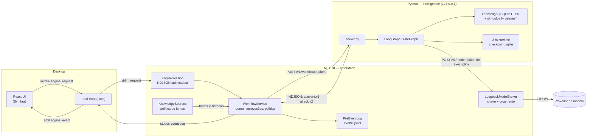
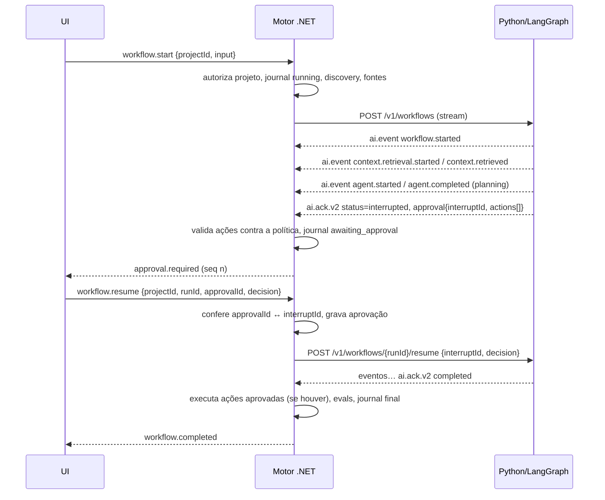

# Auditoria e arquitetura proposta — orquestração de agentes, Agentic RAG e memória

**Fase:** 1 (auditoria) e 2 (proposta de arquitetura e contratos). **Data:** 2026-11-02. **Base:** `master` em `253871e`.
**Estado:** arquitetura aprovada em 2026-11-02. A Fase 2 está em [ADR-0001](adr/0001-langgraph-e-contratos-v2.md), com o resultado do
spike D1 e os schemas em `contracts/schemas/intelligence/`.

Linha de base medida nesta auditoria: **.NET 252 + 2 testes de integração, UI 109 testes, Python 18 testes, todos verdes**.

---

## 0. Resumo executivo

O pedido parte de uma premissa que a auditoria precisa corrigir. **O módulo Python já existe** (`intelligence/`), já é processo
local em loopback com token, já tem um workflow (`engineering.request.v1`), índice lexical incremental por projeto, checkpoint
separado do índice, pausa para aprovação com retomada após reinício, eval de recall e baseline. A separação de responsabilidades
.NET ↔ Python também já está escrita e testada.

O que **não** existe:

1. **LangGraph.** O "grafo" é uma sequência fixa de funções em Python puro, sem dependências (`intelligence/workflows/engineering/graph.py:44`).
2. **Modelo de linguagem nos agentes.** Nenhum nó chama modelo, e o orçamento de tokens é zero (`graph.py:23`). O juiz devolve `not_run`.
3. **Streaming.** O Python devolve uma resposta única no fim. Os eventos `workflow.started`, `context.retrieval.started`,
   `context.retrieved` e `agent.completed` são publicados pelo .NET **depois** que o trabalho terminou (`WorkflowService.cs:91-95`).
   Os eventos são reais, mas a ordem no tempo é reconstruída. Isso contraria o espírito do item 10 do pedido.
4. **Recuperação híbrida.** Só BM25 (FTS5), sem símbolos, sem vetores, sem RRF, sem reranking. A seleção de fontes indexa no máximo
   **40 arquivos** por projeto (`KnowledgeSources.cs:10`).
5. **Interface ao vivo.** A página de execução lê `run.snapshot` uma vez ao abrir e não acompanha eventos (`execution-page.tsx:63`).
   Não há deduplicação, ordenação nem recuperação por `seq`.
6. **Python empacotado fora do Windows.** macOS e Linux caem no Python do `PATH` (`ci.yml`, passo "motor como sidecar"). Isso viola o
   critério 16 do pedido.

A proposta, portanto, **não cria um módulo novo**. Ela troca o motor interno do `intelligence/` por LangGraph mantendo os mesmos
contratos e testes, acrescenta streaming e um proxy de modelo controlado pelo .NET, e evolui o RAG e a interface por etapas medidas.

Há decisões que só você pode tomar. Elas estão na seção 9. A D1 já foi decidida pela medição (ADR-0001); a D2 bloqueia a Fase 3.

---

## 1. Diagnóstico da arquitetura atual

### 1.1 Estrutura e comunicação

| Camada | Pasta | Papel hoje | Observações |
| --- | --- | --- | --- |
| UI | `desktop/ui` | React 19, Vite, Synthra `@synthra.io/ui-kit@0.5.0`, Zod na fronteira | Jornadas: configurar projeto, pedido de engenharia, execução, configurações |
| Host | `desktop/host/src-tauri` | Tauri 2. Sobe o sidecar .NET, repassa NDJSON (`engine_request` → stdin; stdout → evento `engine_event`), diálogo de pasta, recentes | 866 linhas de Rust e sem regra de negócio. `protocol.rs` bloqueia métodos de ciclo de vida e `workspace.authorize` vindos da UI |
| Motor | `runtime/` | .NET 10: Core, Application, Infrastructure, Runtime (NDJSON), Cli | Autoridade sobre workspace, políticas, aprovações, journal, evals determinísticos e chave do modelo |
| Inteligência | `intelligence/` | Python 3.12 stdlib, `http.server` em `127.0.0.1`, porta efêmera, `Bearer` por sessão | Não lê o projeto, não grava, não chama modelo e não publica evento |
| Contratos | `contracts/` | JSON Schema do envelope v1, métodos e eventos de IA, fixtures golden e inválidas | Validados nos testes .NET (`JsonSchema.Net`) e na UI (`engine.test.ts`) |

Fluxo real: **UI → (invoke) → Host → (stdin NDJSON) → Motor .NET → (HTTP loopback) → Python**. Os eventos voltam pelo
caminho inverso, mas **saem só do .NET**. Esse desenho já atende o pedido de que os eventos sejam coordenados pelo .NET e deve ser preservado.

### 1.2 O que já existe e funciona

| Capacidade | Onde | Evidência |
| --- | --- | --- |
| Processo Python local com token, só em loopback, health check e corpo limitado a 1 MB | `intelligence/server.py`, `LoopbackAiRuntime.cs` | `WorkflowRuntimeTests` sobe o servidor real |
| Ciclo de vida do Python pelo motor (sobe sob demanda, reinicia, encerra), `stdin` fechado | `LoopbackAiRuntime.EnsureReadyAsync/ShutdownAsync` | |
| CPython embarcado no Windows (10,6 MB, orçamento de 25 MB) | `scripts/build-runtime.ps1`, `PythonRuntimeLayout.cs` | Passo de CI `Pacote_embarcado` |
| Workflow `engineering.request.v1` com nós Request Analyzer, Context Builder, RAG Research, Planning, Plan Validator, Architecture (opcional), Impact Eval, Approval Gate, Synthesizer e Evaluation Judge | `graph.py` | 10 testes em `test_graph.py` |
| Limites de iterações, tempo e tokens | `graph.py:21-23`, `_over_budget` | `test_limite_de_tempo_encerra_sem_virar_sucesso` |
| Pausa para aprovação, retomada no mesmo processo e após reinício (journal no .NET e checkpoint no Python), cancelamento | `WorkflowService.ResumeAsync`, `memory/execution.py` | `WorkflowRuntimeTests` |
| Checkpoint validado na volta, sem confiar no disco: recusa plano com comando ou impacto adulterado | `_checkpoint_ok` | `test_checkpoint_adulterado_com_comando_nao_volta` |
| Índice lexical incremental por hash, remoção de órfãos, um SQLite por `projectId`, sem cruzar projetos | `knowledge/index.py` | `test_rag.py` |
| Política de fontes no .NET: `.gitignore`, `.env*`, binários, segredos (`SecretScanner`), sem `..`; a mesma política se repete no Python como segunda barreira | `KnowledgeSources.cs`, `index.py:_allowed` | |
| Evidência com proveniência: `documentId`, `chunkId`, `filePath`, `hash`, `score`, `excerpt` | `graph.py:_public_evidence`, schema `context.retrieved` | |
| Eval de recall@k com dataset versionado (`rag.recall.v1`), incluindo o projeto piloto | `evaluations/recall.py` | `test_recall_eval.py` |
| Baseline de regressão do grafo | `evaluations/datasets/baseline.json` | `test_baseline.py` |
| 14 evals determinísticos do harness (config, lock, agentes, skills, hook com payloads reais, segredos, idempotência, regressão…) | `Mariliz.Application/Validation` | |
| Journal de execução atômico em `%LOCALAPPDATA%/Mariliz/projects/<id>/runs/<runId>/journal.json` | `FileRunStore.cs` | |
| Aplicação idempotente com backup, undo verificado por hash e rollback | `Execution/` | `ConfigureJourneyTests`, `SafetyTests` |
| Chave do modelo fora do projeto; proxy no motor; a chave não chega ao Python | `ModelGateway.cs`, `FileModelSettings.cs` | `ModelGatewayTests` |
| Eventos com `seq` por execução e `run.snapshot` com os últimos 100 | `RunHandle.cs` | |

### 1.3 O que está parcialmente implementado

| Item | Estado | Lacuna |
| --- | --- | --- |
| "Grafo" | Pipeline fixo em `for node in (...)` | Sem LangGraph, sem arestas condicionais declaradas, sem paralelismo, sem streaming |
| Agentes | `architecture` determinístico, mapeia stack → área | Nenhum usa modelo; os demais "agentes" são funções sem contrato próprio |
| Juiz por modelo | `ModelJudgeCheck` (.NET) e `evaluation_judge` (Python) devolvem `not_run` | Não registra modelo, versão nem critérios |
| Gateway de modelo | Só OpenAI, `MaxTokens = 256`, timeout de 10 s, prompt de até 4000 caracteres | Insuficiente para planejamento e julgamento reais |
| Chunking | Regex por tipo (títulos de Markdown, chaves de JSON e YAML, início de declarações em código) | Sem AST, no máximo 12 chunks de 1200 caracteres por arquivo, `chunkId = path#n` instável quando o arquivo muda |
| Seleção de fontes | Ranqueada por extensão | **Máximo de 40 arquivos por projeto**; projetos maiores ficam quase todos fora |
| Metadados | path, hash, chunk, projectId | Faltam `language`, `module`, `symbol`, `version`, `createdAt/updatedAt`, `sourceId` |
| Eventos | `seq` existe | A UI ignora `seq`, os eventos vivem só em memória (500 por execução) e se perdem quando o motor reinicia |
| Estados de execução | `analyzing` definido | Nunca emitido |
| Eval no journal | `EvalSummary {id, status, required}` | Evidência completa só em memória; o workflow usa outro vocabulário no mesmo campo (`not_run`/`recorded`) |
| Inventário de MCP | `HarnessInventoryReader` lê `.mcp.json` | Não há cliente MCP, apenas inventário |

### 1.4 O que precisa evoluir e o que precisa ser criado

| Evoluir | Criar (não existe nada equivalente) |
| --- | --- |
| `graph.py` → `StateGraph` do LangGraph, com os mesmos nós e contratos | Streaming de eventos Python → .NET (NDJSON) |
| `memory/execution.py` → checkpointer do LangGraph no mesmo arquivo e na mesma pasta | Proxy de modelo acessível ao Python, com chave e orçamento no .NET |
| `knowledge/index.py` → chunking estrutural, índice de símbolos, metadados, RRF | Persistência de eventos (`events.jsonl`) para recuperação |
| `KnowledgeSources.cs` → fontes configuráveis em `mariliz.yaml`, sem o teto de 40 | Registro de avaliações com modelo, versão, critérios e evidência |
| `ModelGateway` → limites por execução, mais tokens, provedor configurável | Empacotamento do Python em macOS e Linux |
| `execution-page.tsx` → acompanhamento ao vivo por `seq` | |
| `ModelJudgeCheck` / `evaluation_judge` → juiz real, nunca o único veredito | |

### 1.5 Achados fora do escopo (bugs e dívidas encontrados na auditoria)

Ficam registrados para não se perderem. Nenhum bloqueia a proposta.

- `DotnetDetector.cs` ordena frameworks como texto, então `net9.0` vence `net10.0`.
- `PlanSessionStore` descarta com `Keys.First()`, que não é necessariamente o plano mais antigo. `RunTracker._runs` nunca é limpo.
  `WorkspaceAuthorizer._authorized` não é thread-safe.
- `SettingsMerger` grava um campo `args` no hook do `.claude/settings.json`. É preciso confirmar se o esquema de hooks do Claude Code
  aceita esse campo. O `HookCheck` chama o script direto e não exercita essa invocação.
- `run-step.tsx:21`: `await onCancel()` sem tratamento de erro deixa o botão preso em "Cancelando…".
- `PackagedAiSmokeTests` passa sem testar nada quando `MARILIZ_PACKAGED_RESOURCES` não está definido. O verde local é falso.
- Componentes locais que se sobrepõem ao Synthra: `PageHeader` → `Breadcrumb`, `InlineNotice` → `Alert`, `<input>`/`<select>`/`<textarea>`
  nativos → `TextField`/`SelectField`, tabelas nativas → `DataTable`, e `CheckGlyph` → `CheckCircleIcon`.
- O blueprint (`architecture-blueprint.md` §10) diz que o índice fica em `.mariliz/cache/`. O código o grava fora do projeto, e o código está certo.
  O índice fica em `<data>/<projectId>/index.sqlite`, enquanto o restante usa `<data>/projects/<projectId>/…`: um layout inconsistente.

---

## 2. Arquitetura proposta sobre a estrutura existente

### 2.1 Princípios

1. **O Python decide como pensar; o .NET decide o que pode acontecer.** O LangGraph orquestra os nós, mas nenhum nó tem ferramenta com
   efeito colateral. Toda operação com efeito (gravar arquivo, rodar comando, instalar, migrar, escrever em sistema externo) sai do
   Python como **proposta de ação** e só é executada pelo .NET depois da política e da aprovação. É isso que impede um agente de
   contornar uma aprovação delegando a outro agente ou ferramenta: **não existe ferramenta no Python que execute a operação**.
2. **A chave do modelo nunca sai do .NET.** O Python chama um proxy local do motor, e o motor aplica orçamento, redação de segredos e registro.
3. **Os eventos saem só do .NET.** O Python transmite eventos ao .NET enquanto executa. O .NET valida o schema, carimba `seq` e `at`,
   persiste e republica. A UI continua falando só com o host.
4. **Mesmos contratos, motor trocado.** A migração para LangGraph precisa passar nos mesmos testes (`test_graph.py`, `test_baseline.py`,
   `WorkflowRuntimeTests`) antes de qualquer agente novo entrar.
5. **Um único processo Python**, como hoje, hospedando orquestração e RAG. Nenhum microserviço novo.

### 2.2 Organização do módulo Python (evolução, não reorganização)

A pasta atual já segue boa parte da separação sugerida no pedido. O plano só acrescenta o que tiver código para conter:

```text
intelligence/
  server.py                     # mantém; ganha a rota de streaming
  contracts/                    # NOVO: TypedDict/validadores dos schemas de contracts/schemas/ai (sem pydantic, se D1 permitir)
  workflows/engineering/
    graph.py                    # vira a montagem do StateGraph
    nodes/                      # NOVO quando graph.py passar de um arquivo: um nó por arquivo
  agents/                       # NOVO na Fase 6, só para agentes com modelo
  knowledge/                    # mantém o nome (já é o "rag/")
    index.py                    # índice lexical (FTS5)
    chunking/                   # NOVO na Fase 4: markdown, código, json/yaml
    retrieval.py                # NOVO na Fase 4: fusão RRF e filtros
  memory/
    execution.py                # vira o checkpointer do LangGraph
  evaluations/                  # mantém (recall, baseline) e ganha os juízes
  infrastructure/               # NOVO: cliente do proxy de modelo e emissor de eventos
  tests/
```

Os nomes `rag/`, `orchestration/` e `tools/` não são criados. `knowledge/` já cumpre o papel de `rag/`, o LangGraph cumpre o de
`orchestration/`, e ferramentas com efeito vivem no .NET por desenho (princípio 1).

No .NET, entram apenas:

- `Mariliz.Application/Workflows/`: `WorkflowEventStream` (lê o NDJSON e valida), `ActionProposal` e a decisão de política.
- `Mariliz.Application/Models/`: `ModelBudget` (limites por execução).
- `Mariliz.Infrastructure/`: `LoopbackModelBroker` (`HttpListener` da BCL, sem pacote novo) e `FileEventLog` (`events.jsonl`).

---

## 3. Diagrama de comunicação



Sequência do primeiro workflow com aprovação:



---

## 4. Matriz de responsabilidades

| Responsabilidade | UI | Host (Rust) | Motor (.NET) | Python (LangGraph) |
| --- | --- | --- | --- | --- |
| Janela, diálogo de pasta, ciclo de vida do motor | | **R** | | |
| Ciclo de vida, health e reinício do Python | | | **R** | responde `/health` |
| Autorização de projeto/workspace, `projectId` | | diálogo | **R** | só valida o formato |
| Regras de negócio, casos de uso, persistência de domínio | | | **R** | — |
| Política de fontes indexáveis (`.env`, segredos, binários, `.gitignore`, `mariliz.yaml`) | | | **R** | segunda barreira |
| Ingestão, chunking, indexação e recuperação | | | envia fontes | **R** |
| Orquestração, roteamento, estado do grafo, checkpoints | | | | **R** |
| Chamada a modelo (chave, orçamento, redação, registro de uso) | | | **R** (proxy) | pede pelo proxy |
| Decisão "precisa de aprovação?" | | | **R** (política) | sinaliza a intenção |
| Registro e validação de aprovações | coleta a decisão | | **R** | retoma com o valor validado |
| Execução de efeitos (arquivos, comandos, instalações) | | | **R** | nunca |
| Evals determinísticos (contratos, schemas, testes, arquitetura) | | | **R** | os de RAG/grafo nos próprios testes |
| Evals por modelo (qualidade do plano, contexto, coerência) | | | registra | **R** (executa via proxy) |
| Eventos: origem | | | carimba `seq`/`at`, persiste, publica | emite durante a execução |
| Eventos: apresentação, ordenação e deduplicação | **R** | repassa | fornece `sinceSeq` | |
| Observabilidade (journal, uso de tokens, decisões) | apresenta | | **R** (dono do registro) | fornece os dados |

**R** = responsável e autoridade.

---

## 5. Contratos de integração

Os contratos novos seguem o padrão existente: JSON Schema em `contracts/schemas/ai/`, fixtures em `contracts/fixtures/`, e validação
nos testes .NET e Python. Nenhum objeto de domínio atravessa a fronteira.

### 5.1 Compatibilidade

- `workflow.start.v1` (motor → Python) continua aceito até a Fase 3 terminar. O `v2` entra em paralelo, e o servidor escolhe pelo campo `schema`.
- O protocolo UI ↔ motor (`envelope.v1`) **não muda**. Os eventos novos são apenas novos valores de `type`. A UI já ignora tipos desconhecidos.
- Os nomes do pedido (PascalCase) seguem a convenção já publicada (minúsculo com ponto): `WorkflowStarted` → `workflow.started`.

### 5.2 Motor → Python: `ai.workflow.start.v2`

```json
{
  "schema": "ai.workflow.start.v2",
  "workflowId": "engineering.request",
  "workflowVersion": "2",
  "runId": "run-0123456789ab",
  "executionId": "ex-0123456789ab",
  "projectId": "p-0123456789ab",
  "workspaceId": null,
  "input": { "goal": "…", "impact": true, "requiresApproval": false },
  "context": { "stacks": ["dotnet"], "knowledgeRoot": "…", "executionRoot": "…", "sources": [ { "path": "…", "hash": "…", "text": "…" } ] },
  "limits": { "maxIterations": 8, "maxMilliseconds": 60000, "maxTokens": 20000, "maxCostUsd": 0.10 },
  "policy": { "allowedActions": ["file.write"], "modelAllowed": true },
  "broker": { "url": "http://127.0.0.1:<porta>/v1/model", "token": "<token desta execução>" }
}
```

- `workspaceId`: o domínio atual não tem workspace diferente de projeto (uma pasta autorizada → um `projectId`). O campo fica
  reservado e nulo até o .NET definir o conceito (decisão D7). Não se cria a abstração antes disso.
- `limits` e `policy` vêm do .NET. O Python só pode ser mais restritivo.
- `broker.token` vale só para esta `executionId` e morre quando ela termina. Não é a chave do provedor.

### 5.3 Python → Motor: fluxo `application/x-ndjson`

Cada linha é um `ai.event.v1`. A última é um `ai.ack.v2`.

```json
{ "schema": "ai.event.v1", "eventId": "ex-…:7", "executionId": "ex-…", "localSeq": 7, "type": "agent.completed",
  "agentId": "planning", "at": "2026-11-02T19:00:00.000Z", "data": { "durationMs": 412, "tokens": 0 } }
```

O `localSeq` é monotônico na execução Python. O .NET descarta duplicatas por `eventId`, atribui o `seq` público e grava em `events.jsonl`.

Catálogo de eventos (✅ já existe · 🆕 novo):

| Evento do pedido | `type` | Dados mínimos |
| --- | --- | --- |
| WorkflowStarted | ✅ `workflow.started` | workflowId, executionId, status, at |
| ContextRetrievalStarted | ✅ `context.retrieval.started` | at, `strategy` 🆕 (`lexical`, `symbol`, `vector`) |
| ContextRetrieved | ✅ `context.retrieved` | documentId, chunkId, filePath, hash, score, at, `retriever` 🆕 |
| AgentStarted | 🆕 `agent.started` | agentId, agentVersion, at |
| AgentProgressUpdated | 🆕 `agent.progress` | agentId, `activity` (código, nunca texto livre do modelo), at |
| ToolExecutionStarted / Completed | 🆕 `tool.started` / `tool.completed` | toolId, `effect: none`, durationMs. Só ferramentas sem efeito rodam no Python |
| ApprovalRequired | 🆕 `approval.required` | approvalId, actions[] (resumo), at |
| AgentCompleted | ✅ `agent.completed` | agentId, at, durationMs 🆕, tokens 🆕 |
| EvaluationStarted / Completed | 🆕 `eval.started` / `eval.completed` | evalId, kind (`deterministic`, `model`), outcome. Mesmo nome proposto em `docs/redesign/contratos-propostos.md` §3 |
| WorkflowInterrupted | ✅ `workflow.interrupted` | + approvalId 🆕 |
| WorkflowFailed | ✅ `workflow.failed` | + code |
| WorkflowCompleted | ✅ `workflow.completed` | |

### 5.4 Resultado de agente: `ai.agent.result.v1`

Todo agente devolve este envelope. O campo `output` tem schema próprio por agente (como `engineering.plan.v1` e `engineering.impact.v1` já fazem).

```json
{
  "schema": "ai.agent.result.v1",
  "agentId": "planning", "agentVersion": "1",
  "executionId": "ex-…", "status": "completed",
  "startedAt": "…", "completedAt": "…",
  "inputDigest": "sha256 do input normalizado",
  "output": { "schema": "engineering.plan.v1", "steps": [] },
  "evidence": ["docs/a.md#h2:instalacao"],
  "warnings": [{ "code": "RAG_NO_HITS", "message": "…" }],
  "errors": [],
  "nextActions": [{ "id": "act-1", "kind": "file.write", "summary": "…", "requiresApproval": true }],
  "approvalRequired": true,
  "usage": { "model": "…", "modelVersion": "…", "inputTokens": 0, "outputTokens": 0 }
}
```

- `evidence` só aceita `chunkId` que veio da recuperação desta execução. Essa regra já existe em `_impact_ok` e vira geral.
- `nextActions` são **propostas**. O .NET mapeia `kind` para a política (`file.write`, `command.run`, `dependency.install`,
  `config.change`, `migration.run`, `external.write`) e decide se precisa de aprovação, mesmo que o agente diga que não precisa.

### 5.5 Fim da execução: `ai.ack.v2`

É o `workflow.ack.v1` atual mais `startedAt`, `completedAt`, `agents[]` (resumos de `ai.agent.result.v1`), `usage` agregado e,
quando `status = interrupted`, `approval: { interruptId, actions[] }`. `limitations` continua com o mesmo formato (`code`, `message`)
e passa a se chamar `warnings` no v2. O .NET mapeia os dois nomes.

### 5.6 Proxy de modelo: `POST /v1/model` (Python → .NET)

```json
{ "schema": "ai.model.request.v1", "executionId": "ex-…", "agentId": "planning", "purpose": "plan",
  "messages": [{ "role": "system", "content": "…" }, { "role": "user", "content": "…" }], "maxTokens": 1024, "responseSchema": "engineering.plan.v1" }
```

A resposta traz `text`, `model`, `modelVersion`, `inputTokens`, `outputTokens` e `costUsd`, ou um erro `MODEL_BUDGET_EXCEEDED`,
`MODEL_NOT_CONFIGURED` ou `MODEL_TIMEOUT`. O .NET recusa qualquer chamada fora do orçamento da execução e registra o uso no journal.

### 5.7 Retomada: `ai.workflow.resume.v2`

`{ runId, executionId, projectId, interruptId, decision: { approvalId, approved, actionIds[] } }`. O Python só retoma se `interruptId`
for o do checkpoint. O .NET só envia se `approvalId` estiver gravado no journal com o mesmo hash das ações propostas.

---

## 6. Estratégia de RAG e memória

### 6.1 Armazenamento: continuar em SQLite

| Opção | Execução local | Distribuição desktop | Manutenção | Veredito |
| --- | --- | --- | --- | --- |
| **SQLite FTS5 (atual) + `sqlite-vec` quando houver vetores** | no mesmo arquivo, sem processo novo | stdlib + uma extensão nativa pequena por plataforma | um arquivo por projeto, já isolado e testado | **Recomendado** |
| Chroma embarcado | sim | puxa onnxruntime, numpy e outras dependências pesadas; passa do orçamento | depende de versão e migrações próprias | não |
| Qdrant | processo/binário separado | mais um executável por OS para assinar e notarizar | outro ciclo de vida para o Tauri cuidar | não |
| LanceDB | sim | pyarrow pesado | | não |

O tamanho real do `sqlite-vec` por plataforma precisa ser medido na Fase 2. A extensão só entra quando D3 for decidida.

### 6.2 Pipeline de ingestão (dono de cada etapa)

| # | Etapa | Dono | Estado |
| --- | --- | --- | --- |
| 1 | Descoberta das fontes | .NET (`KnowledgeSources`) | existe; tirar o teto de 40 e usar orçamento por bytes |
| 2 | Validação de permissões | .NET (`.gitignore` com curingas, `.env*`, binários, `SecretScanner`, `mariliz.yaml: knowledge.include/exclude`) | parcial: o `.gitignore` ignora padrões com `*` |
| 3 | Extração | .NET (texto) | existe |
| 4 | Normalização (EOL, BOM, tamanho) | Python | criar |
| 5 | Metadados (§6.4) | Python, com o que o .NET enviar (stack, módulo) | criar |
| 6 | Chunking estrutural (§6.3) | Python | evoluir |
| 7 | Embeddings | Python via proxy ou modelo local (D3) | adiado até a medição |
| 8 | Indexação (FTS5 + símbolos [+ vetores]) | Python | evoluir |
| 9 | Validação da indexação (contagem e hash por documento, consulta-sonda) | Python, retornada ao .NET | criar |
| 10 | Versão do conteúdo (`documentVersion`, `indexSchemaVersion`) | Python | criar |

O .NET já envia o texto só dos arquivos cujo hash mudou (`indexed` vs `hash`). Esse mecanismo continua sendo a base da indexação
incremental. Uma falha no meio de um `sync` não corrompe o índice, porque a sessão é uma única transação SQLite.

### 6.3 Chunking estrutural

| Fonte | Estratégia | Dependência |
| --- | --- | --- |
| Markdown | Por título, com o caminho de títulos (`# A > ## B`) como metadado e prefixo do chunk | nenhuma (hoje já corta por título) |
| JSON / YAML | Por chave de topo e, se grande, por subárvore, com o caminho da chave | nenhuma (`json`; YAML por indentação) |
| Python | `ast` da stdlib: classe, função e método, com nome qualificado | nenhuma |
| C#, TypeScript/JavaScript | Tree-sitter com gramáticas avulsas (`tree-sitter-c-sharp`, `tree-sitter-typescript`), só se a Fase 4 medir ganho de recall sobre o regex atual e o tamanho couber no orçamento | D1 |
| Especificações (`.specs/`, requisitos EARS) | Por requisito ou critério de aceite (`REQ-…`, `AC-…`), com o id como símbolo | nenhuma |
| Outros | Parágrafos | nenhuma |

O `chunkId` passa a ser estável: `path#<tipo>:<caminho estrutural>` (por exemplo `src/A.cs#method:Billing.Charge`), no lugar de `path#n`.
Assim a evidência continua apontando para o mesmo trecho quando o arquivo muda em outro lugar.

### 6.4 Metadados por chunk

`projectId`, `sourceId` (`project-files`, futuramente conectores), `documentId` (path), `filePath`, `fileType`, `language`,
`technology` (stack do discovery), `module` (pasta de topo ou projeto .NET/pacote), `symbol`, `contentHash`, `documentVersion`,
`chunkId`, `provenance` (`project-files@<commit git, se houver>`), `createdAt`, `updatedAt`.

O campo `permissions` do pedido não é armazenado por chunk. A permissão é decidida antes da ingestão (etapa 2), e o que não pode ser
lido não entra no índice. Guardar a permissão no chunk sugeriria um filtro que nunca deveria ser necessário.

### 6.5 Recuperação híbrida

1. **Lexical (BM25/FTS5):** já existe.
2. **Símbolos e identificadores:** tabela `symbols(name, kind, chunk_id)`. Consultas com `PascalCase`, `snake_case` ou `Pontos.Qualificados` vão direto para ela.
3. **Vetorial:** só depois de D3 e de uma baseline que mostre ganho.
4. **Filtros por metadados** (language, module, fileType) vindos do plano.
5. **Fusão RRF** (k = 60) entre as listas disponíveis.
6. **Reranking:** começa determinístico (cobertura de termos, proximidade, tipo de arquivo pedido). Um reranker por modelo fica para depois e precisa ganhar na eval.

Critério de entrada de cada camada: **recall@k e MRR no dataset `rag.recall.v1` não pioram e melhoram em pelo menos um grupo de casos**.
O dataset ganha casos por tipo (código, Markdown, spec, símbolo) e o projeto piloto como corpus real.

### 6.6 Proteção das fontes

A política atual já cobre `.env*`, chaves, binários, `node_modules`, `bin/obj`, `dist`, `.git` e segredos. Faltam:

- `.gitignore` com curingas (`*.log`, `**/secrets/*`), que hoje são ignorados (`KnowledgeSources.cs:65`).
- Padrões `id_*`, `credentials.*` e `secrets.*` (o hook já os conhece em `mariliz-policy.py`; unificar a lista).
- Lockfiles e minificados (`*.min.js`, `pnpm-lock.yaml`), que são ruído.
- Configuração explícita em `mariliz.yaml` (`knowledge.include`, `knowledge.exclude`), lida só pelo .NET.

**Trechos recuperados são dados não confiáveis.** Nos prompts, entram dentro de um bloco delimitado e marcado como conteúdo do projeto,
nunca como instrução. As saídas dos agentes passam pelo validador de schema, e as chaves proibidas (`_FORBIDDEN` em `graph.py`) continuam valendo.

### 6.7 Memória

| Memória | O que guarda | Onde | Dono | Vida útil |
| --- | --- | --- | --- | --- |
| Working | Estado do grafo durante a execução (objetivo, decisões, evidências) | `State` do LangGraph, em memória | Python | a execução |
| Execution | Checkpoints, interrupções, retomada | `<data>/projects/<id>/execution/checkpoint.sqlite` (já existe) | Python | apagado quando a execução termina ou é cancelada |
| Project Knowledge | Índice do conhecimento **aprovado** do projeto | `<data>/projects/<id>/knowledge/index.sqlite` (move de `<data>/<id>/`; reconstruível, sem migração) | Python indexa; .NET decide as fontes | enquanto o projeto estiver autorizado |
| Engineering History | Planos, decisões, aprovações, ações, testes, regressões | `<data>/projects/<id>/runs/<runId>/journal.json` + `events.jsonl` (novo) | **.NET** | permanente |
| Evaluation | Datasets, baselines, resultados com modelo, versão e critérios | datasets no repositório do produto (`intelligence/evaluations/datasets`) e no projeto (`.mariliz/evals/`); resultados em `<data>/projects/<id>/evals/` | .NET registra; Python executa as de IA | permanente |

Regras:

- O checkpoint **não substitui** o journal. O .NET decide o estado da execução, e o checkpoint só serve para retomar o grafo. Essa já é a regra atual.
- O checkpoint não guarda o texto livre do pedido além do necessário para retomar, nem a chave, nem tokens do proxy.
  O `broker.token` é renovado na retomada.
- Conhecimento produzido por agente (ex.: "decisão arquitetural") **não** entra no índice automaticamente. Ele vira proposta de
  arquivo em `.mariliz/` ou `.specs/`, passa por aprovação, e só então é indexado como fonte do projeto.

---

## 7. Estratégia de orquestração

### 7.1 Do pipeline para o `StateGraph`

| Nó atual (`graph.py`) | Nó LangGraph | Muda o quê |
| --- | --- | --- |
| `request_analyzer` | `analyze_request` | Fase 6: classificação de intenção por modelo, com fallback determinístico |
| `context_builder` | `build_context` | nada na Fase 3 |
| `rag_research` | `retrieve` | emite eventos durante a execução; Fase 4 traz a recuperação híbrida |
| `planning_agent` | `plan` | Fase 6: plano por modelo com `responseSchema` |
| `plan_validator` | `validate_plan` | aresta condicional: inválido → `fail`, ou `plan` de novo (até N vezes) |
| `architecture_agent` + `impact_eval` | `architecture` → `check_impact` | aresta condicional por `asks_impact` |
| `approval_gate` | `approval` com `interrupt()` | o valor da retomada vem validado pelo .NET |
| `synthesizer` | `synthesize` | |
| `evaluation_judge` | `evaluate` | Fase 7: juiz por modelo (ver §8) |

Arestas condicionais, limites (`recursion_limit` do LangGraph mais o orçamento do .NET), cancelamento (o .NET encerra o stream e chama
`/cancel`) e streaming (`stream_mode=["updates", "custom"]` → `ai.event.v1`) substituem o `for` atual sem mudar as saídas.

**Checkpointer:** a primeira opção é o pacote `langgraph-checkpoint-sqlite` apontando para o mesmo `checkpoint.sqlite`. Se as
dependências transitivas não couberem no orçamento (D1), escrevemos um `BaseCheckpointSaver` sobre `memory/execution.py`. Nos dois casos
a validação `_checkpoint_ok` (recusar checkpoint adulterado) continua, agora como validação do estado restaurado antes de `interrupt` devolver.

### 7.2 Agentes: quem entra e quando

A regra do pedido é que cada agente exista por benefício demonstrável. A avaliação:

| Agente pedido | Situação hoje | Proposta | Quando |
| --- | --- | --- | --- |
| Request Analyzer | nó determinístico | mantém; ganha modelo quando a eval mostrar ganho na classificação | Fase 6 |
| Context Builder | nó vazio | mantém como nó (stacks, módulos, discovery); **não** é agente com modelo | Fase 3 |
| RAG Research Agent | nó determinístico | vira subgrafo de recuperação (consulta → estratégia → fusão); modelo só para reescrever a consulta, se a eval provar ganho | Fases 4 e 6 |
| Planning Agent | nó determinístico | **primeiro agente com modelo**: plano em `engineering.plan.v1`, validado e com evidência obrigatória | Fase 6 |
| Architecture Agent | nó determinístico | evolui para modelo com evidência obrigatória por área | Fase 6 |
| Evaluation Judge | stub `not_run` | juiz por modelo **independente** do agente avaliado (outro prompt, outro critério e, se possível, outro modelo) | Fase 7 |
| Specification Agent | — | adiado: depende da jornada "Requisitos e documentação" do roadmap | depois da Fase 7 |
| Harness Engineer | agente `.md` que roda no ambiente de IA da pessoa e grava `.mariliz/proposal.json` | decisão D5: continuar fora do produto ou virar nó com modelo que produz a mesma proposta | D5 |
| Tools & MCP Agent | — | adiado: não há cliente MCP; o inventário já existe no discovery | Fase 4 do roadmap do produto |
| Code Analysis Agent | — | adiado: depende do chunking por AST e do índice de símbolos | depois da Fase 4 |

Contrato de cada agente (mesmo formato para todos, registrado em `contracts/schemas/ai/agents/<id>.v1.schema.json`):

| Campo | Exemplo (Planning) |
| --- | --- |
| Responsabilidade | transformar o pedido e o contexto em etapas verificáveis |
| Entrada | goal, stacks, evidências (chunkIds), limites |
| Saída | `engineering.plan.v1` (etapas com id, título, critério de conclusão, evidências) |
| Ferramentas permitidas | `retrieve` (sem efeito) |
| Critério de conclusão | schema válido, ≥ 1 etapa, toda evidência citada foi recuperada nesta execução, sem chaves proibidas |
| Falha | `PLAN_INVALID` após N tentativas → `workflow.failed` |

---

## 8. Avaliação de qualidade, governança e observabilidade

**Avaliação:**

| Camada | O que | Onde | Bloqueia? |
| --- | --- | --- | --- |
| Determinística | schemas de contrato, chaves proibidas, evidência rastreável, limites, idempotência, evals do harness (14 existentes), recall/baseline | .NET e Python | **sim** |
| Por modelo | qualidade do plano, adequação do contexto, coerência arquitetural, atendimento ao pedido | Python via proxy; o .NET registra | não, até haver baseline. Depois, só como limitação |
| Regressão | `baseline.json` do grafo, `rag.recall.v1`, `RegressionCheck` | CI | sim |

Cada resultado por modelo é registrado com `evalId`, `criteriaVersion`, `model`, `modelVersion`, `promptHash`, evidências, nota e
justificativa curta, em `<data>/projects/<id>/evals/<executionId>.json`. O juiz nunca avalia a própria saída. Na CI, os juízes rodam
com modelo falso determinístico, e uma suíte manual (fora da CI) roda com modelo real sobre o dataset.

**Governança:** já existem o limite de iterações e de tempo, o cancelamento, a idempotência do apply, a aprovação de alterações e
comandos e a política de caminhos. Entram:

- orçamento de tokens e custo por execução, aplicado no proxy;
- allowlist de tipos de ação por workflow (`policy.allowedActions`);
- `approvalId` ligado ao hash das ações (§5.7);
- registro de aprovações no journal (quem, quando, o quê);
- timeout por chamada de modelo;
- ações repetidas na retomada não executam de novo (chave de idempotência = `executionId:actionId`).

**Segurança e isolamento:**

- `projectId` validado nos dois lados (já existe), um índice e um checkpoint por projeto (já existe), e o proxy recusa `executionId`
  de outro projeto.
- Os logs do Python ficam desligados (`log_message` vazio, como hoje). Os do .NET passam por `SecretScanner.RedactLines`.
- Telemetria de terceiros desligada e testada. O `langchain-core` traz o `langsmith`, então o ambiente do processo define
  `LANGSMITH_TRACING=false`, e um teste garante que nenhuma conexão sai do loopback.

**Observabilidade:** `events.jsonl` + journal + registro de evals respondem "por que o agente decidiu isso": que chunks entraram,
que modelo, quantos tokens, que aprovação. A UI lê esses dados pelo `run.snapshot`, que passa a aceitar `sinceSeq`.

---

## 9. Riscos técnicos e decisões pendentes

### 9.1 Decisões (as marcadas com ⛔ bloqueiam a Fase 3)

| # | Decisão | Opções | Recomendação |
| --- | --- | --- | --- |
| ✅ D1 | **Orçamento de tamanho do Python.** Hoje: 25 MB para o interpretador, com scripts só stdlib. LangGraph traz `langchain-core`, `langsmith`, `pydantic`/`pydantic-core`, `httpx`, `orjson` e outros | (a) aceitar o aumento, medido por plataforma; (b) LangGraph sem extras e com dependências podadas; (c) não usar LangGraph e evoluir o grafo atual | **Decidida (ADR-0001):** (a). Medido: 48 MB no disco (interpretador 21,5 + dependências em bytecode 26,6), cerca de +8 MB no instalador, importação em ~0,7 s, nenhuma conexão de rede |
| ✅ D2 | **Python em macOS e Linux** (decidida: python-build-standalone; ADR-0001). Hoje cai no `PATH`, o que viola o critério 16 | (a) `python-build-standalone` por plataforma; (b) Python só no Windows por enquanto | (a), assinado junto com o sidecar no macOS |
| D3 | **Embeddings** | (a) API do provedor via proxy (manda código do projeto para fora; exige consentimento explícito por projeto); (b) modelo local ONNX (dezenas a centenas de MB); (c) adiar até a eval mostrar ganho | (c) e depois (a) com consentimento; (b) só se houver exigência de rodar offline |
| D4 | **Provedor e limites do modelo** (bloqueia a Fase 6, não a 3). Hoje: só OpenAI, 256 tokens, 10 s | provedores suportados, modelo padrão, teto de custo por execução | definir antes da Fase 6; a Fase 3 só precisa de "o proxy existe e o modelo pode ser falso nos testes" |
| D5 | **Harness Engineer** | continuar no ambiente de IA da pessoa, ou rodar dentro do Mariliz | manter como está até a Fase 6; reavaliar com o Planning funcionando |
| D6 | **Atualizar o blueprint.** `architecture-blueprint.md` diz "a intelligence não chama modelo" e "não há módulo Python de agentes". Este pedido muda as duas regras | aprovar a mudança | atualizar o blueprint junto com a Fase 2 |
| D7 | **Workspace ≠ projeto?** O pedido cita `WorkspaceId`; o domínio só tem `projectId` | criar o conceito agora, ou reservar o campo | reservar o campo nulo (§5.2) |
| D8 | **Ordem das fases.** O pedido põe a interface na Fase 9, mas a página de execução hoje não acompanha nada ao vivo | manter a ordem, ou trazer o mínimo para a Fase 3 | trazer para a Fase 3 só o acompanhamento por `seq` na página de execução (sem redesenho). O redesenho do Workbench (fase 6 do redesign, também aguardando aprovação) continua na Fase 9 |

### 9.2 Riscos

| Risco | Impacto | Mitigação |
| --- | --- | --- |
| CPython embed não tem `pip` nem `site-packages` por padrão | dependências não carregam | instalar com `--target` numa pasta do pacote e acrescentá-la ao `._pth` (o build já edita o `._pth`); teste de fumaça no pacote |
| Tamanho do instalador e tempo de inicialização do Python com LangGraph | experiência pior; `EnsureReadyAsync` espera 100 ms por tentativa | medir o tempo de importação; subir o Python já no `workflow.start` do primeiro pedido (hoje já é sob demanda) |
| Vulnerabilidades e ritmo de mudança do ecossistema LangChain | manutenção | versões fixadas com hash (`--require-hashes`), CI com auditoria de dependências, uso só do núcleo do LangGraph |
| Telemetria/egress do `langsmith` | vazamento de contexto | variável desligada no ambiente do filho e teste de "nenhuma conexão fora do loopback" |
| Streaming com o `http.server` da stdlib | conexões presas | `Connection: close` e escrita por linha; timeout no .NET; cancelamento fecha o stream |
| Prompt injection nos trechos recuperados | o agente desobedece à política | trechos delimitados como dados; saída validada por schema; o agente não tem ferramenta com efeito (princípio 1) |
| Custo de modelo sem controle | conta do usuário | orçamento por execução no proxy; padrão conservador; registro de uso visível |
| Regressão do comportamento atual na migração para LangGraph | quebra de contrato | a Fase 3 só fecha com `test_graph.py`, `test_baseline.py`, `WorkflowRuntimeTests` e os goldens intactos |
| `PackagedAiSmokeTests` passa vazio fora da CI | falso verde | falhar explicitamente quando a variável não existe e o teste for pedido pelo filtro |

---

## 10. Plano incremental de implementação

Cada fase termina com tudo verde (.NET, Python, UI, contratos) e não começa sem a anterior validada.

| Fase | Entrega | Validação | Tamanho |
| --- | --- | --- | --- |
| **2 — Arquitetura e contratos** | Este documento aprovado; ADR com D1–D8 decididas; schemas `ai.workflow.start.v2`, `ai.event.v1`, `ai.ack.v2`, `ai.agent.result.v1`, `ai.model.request.v1`, `ai.workflow.resume.v2` com fixtures; spike medindo o tamanho e o tempo de importação do LangGraph sobre o CPython embed; blueprint atualizado | testes de contrato .NET e Python sobre as fixtures novas | P |
| **3 — Primeiro workflow em LangGraph** | `graph.py` como `StateGraph` com os mesmos nós; checkpointer; `interrupt()`; streaming NDJSON; `WorkflowEventStream` no .NET; `events.jsonl`; `run.snapshot` com `sinceSeq`; página de execução acompanhando por `seq` (D8); dependências empacotadas no Windows | todos os testes atuais intactos; testes novos: ordem real dos eventos, deduplicação por `eventId`, retomada após matar o Python durante a pausa, cancelamento durante o stream, nenhuma conexão fora do loopback | M |
| **4 — Agentic RAG** | Fontes configuráveis em `mariliz.yaml` e sem o teto de 40; `.gitignore` com curingas; chunking estrutural com `chunkId` estável; metadados; índice de símbolos; RRF; reranking determinístico; validação da indexação; índice movido para `projects/<id>/knowledge/` | `rag.recall.v1` ampliado por tipo de fonte, recall@k e MRR iguais ou melhores; teste de não cruzar projetos; teste de arquivo de segredo nunca indexado | M |
| **5 — Memória** | Separação das cinco memórias (§6.7) com testes de onde cada uma grava; conhecimento produzido por agente vira proposta, não índice | testes de isolamento e de limpeza do checkpoint; nada de segredo nos SQLite (varredura com `SecretScanner` na CI) | P |
| **6 — Multiagentes** | Proxy de modelo no .NET com orçamento; Planning com modelo; Architecture com evidência obrigatória; Request Analyzer por modelo só se a eval mostrar ganho | testes com modelo falso determinístico; suíte manual com modelo real; baseline nova do grafo | M |
| **7 — Evals e governança** | Juiz por modelo independente; registro de evals com modelo, versão e critérios; `eval.started`/`eval.completed`; ações propostas → política → aprovação ligada ao hash → execução pelo .NET com idempotência | testes de "agente não contorna aprovação" (ação sem aprovação, aprovação de outra execução, hash diferente, retomada repetida) | M |
| **8 — Integração desktop** | Python empacotado em macOS e Linux (D2); assinatura; telemetria desligada; reinício do Python com execução em andamento | smoke do instalador nos três sistemas na CI; `PackagedAiSmokeTests` sem falso verde | M |
| **9 — Interface** | Workspace de execução: etapas do grafo, agentes, evidências com origem, ferramentas, aprovações, falhas e evals, a partir dos eventos reais; resolução das sobreposições com o Synthra (§1.5); WCAG 2.2 AA | testes de componente com `axe`; teste de que a tela só mostra o que veio em evento | G |
| **10 — Validação** | Testes de ponta a ponta no app empacotado, regressão, segurança (injeção nos documentos, cruzamento de projetos, segredo em logs e índices) | relatório de validação | M |

P = pequeno, M = médio, G = grande.

**Andamento:**

**Fase 2:** entregue. ADR-0001, schemas e fixtures v2, blueprint atualizado.

**Fase 3:** entregue no motor e na inteligência, sem a parte da interface.

- `graph.py` virou um `StateGraph` com os mesmos nós e a mesma baseline. A pausa usa `interrupt()`, e o `SqliteSaver` grava em
  `projects/<id>/execution/checkpoint.sqlite`.
- Os eventos saem em NDJSON durante a execução. O motor descarta duplicatas e atrasados (`AiEventFilter`) e grava `events.jsonl`.
  Na aprovação, abre `approvalId` no journal e publica `approval.required`.
- `run.snapshot` aceita `sinceSeq` e completa a resposta com o histórico em disco. Depois de um reinício, a numeração continua de onde parou.
- Dependências fixadas com hash em `intelligence/requirements.lock` e instaladas por `scripts/package-intelligence.py`.
- A CI monta o pacote nas três plataformas.

**D8:** a página de execução acompanha os eventos reais (`features/execution/domain/run-timeline.ts`, `hooks/use-run-follow.ts`).

- Escuta antes de ler o retrato, aceita só o próximo `seq` e ignora repetidos e atrasados.
- Uma lacuna dispara `run.snapshot` com `sinceSeq`.
- Ao fim (`run.completed`), busca o resultado no retrato.
- A linha do tempo "O que aconteceu" mostra só eventos publicados pelo motor.

A validação foi feita com testes de componente; no app Tauri ainda não.
