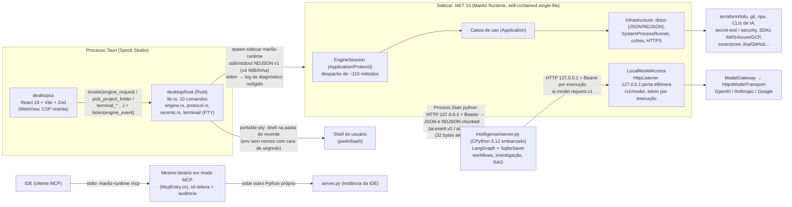

# Auditoria de arquitetura

> Parte da auditoria estratégica do SPOCK (2026-11-15). Navegação e método em [README.md](README.md).
> Somente leitura: nenhum código foi alterado. Legenda de estados: A implementado e validado, B parcial, C só documentado,
> D não implementado, E substituído por melhoria válida, F substituído sem justificativa, G regressão, H conflito entre
> documento e código, I decisão pendente, J não se aplica.

Data: 2026-11-15. Branch auditada: `feat/conformidade-licencas` (limpa, HEAD 06443a5). Modo: somente leitura (nenhum arquivo do
repositório alterado). Escopo: `desktop/host` (Rust/Tauri), `desktop/ui` (React/TS), `runtime/` (.NET 10), `intelligence/`
(Python/LangGraph), `contracts/`, `scripts/`, `.github/workflows/ci.yml`.

Convenção: "não verificado" = não confirmei por leitura ou execução. Caminhos relativos à raiz do repositório.

---

## 0. Resumo executivo

- A arquitetura real é **quatro processos e três runtimes**: WebView (React) → host Rust (Tauri) → sidecar .NET
  (`mariliz-runtime`, NDJSON em stdio) → servidor Python (HTTP em 127.0.0.1 com token Bearer) → que chama de volta um **proxy
  de modelo HTTP no próprio .NET** (127.0.0.1, token por execução). O desenho é coerente, defensivo e bem testado.
- As fronteiras de dependência do .NET estão corretas (Core sem dependências; Infrastructure → Application → Core; sem ciclos).
  Não há "god class" por tamanho: o maior arquivo de produção tem 829 linhas (`IacAwsGenerator.cs`).
- O ponto arquitetural mais relevante não é tamanho, é **dispersão de responsabilidade de IA**: a regra "Python faz a IA" é
  só parcial. Quatro casos de uso .NET chamam o modelo diretamente com prompts próprios (ideias, IaC, assistente de gestão,
  portfólio), e o Python faz o restante (workflow de engenharia, investigação, RAG). Há prompts em duas linguagens.
- O host Rust faz mais que hospedar: tem um **terminal PTY interativo** (shell real na pasta do projeto) e uma **tabela de
  prazos por método de domínio** (IaC, investigação). O terminal contradiz o blueprint ("host não executa comandos
  arbitrários") e não tem ADR/modelo de ameaça.
- A lista de métodos do protocolo existe em **três lugares** (C#, Rust, TS). Só TS↔Rust é conferido por teste.
- Contratos: envelope v1 + golden fixtures conferidas em C# (JSON Schema), TS (Zod) e Python (stdlib). Apenas **6 schemas de
  método** existem em `contracts/schemas/protocol/methods/` para ~110 métodos; a geração de tipos TS prevista nunca foi feita.
- Testes: .NET 1.467 aprovados/25 ignorados/0 falhas; Rust 45/45; Python 192 (1 erro intermitente sob carga, 192/192 ao
  reexecutar); UI 837 (8 timeouts sob carga, 98/98 ao reexecutar os 6 arquivos). **A CI do GitHub está sem orçamento**
  (`docs/distribuicao.md:43`), então o gate real é `scripts/verify.py` na máquina do dono.
- Sem atualização automática, instaladores sem assinatura, CPython embed do Windows baixado **sem verificação de hash**.

---

## 1. Diagrama de componentes reconstruído



### 1.1 Transportes, autenticação e validação

| Trecho | Transporte | Autenticação | Validação | Evidência |
|---|---|---|---|---|
| UI → host | IPC Tauri (`invoke`) | capabilities da janela `main` (12 permissões; sem shell/fs na UI) | Host confere só o envelope (`v`, `kind`, `id` ≤64, método na allowlist, `params` objeto, ≤4 MiB) | `desktop/host/src-tauri/capabilities/default.json`; `src/protocol.rs:184-244` |
| host → .NET | stdin/stdout NDJSON, protocolo v1 | nenhuma (pipe privado do processo filho) | Handshake `engine.hello` obrigatório; host descarta linhas fora do protocolo | `src/engine.rs:117-145`, `src/protocol.rs:252-269`; `EngineSession.cs:202-221, 342-356` |
| .NET → Python | HTTP/1.1 em 127.0.0.1, porta efêmera; respostas longas em NDJSON chunked | `Authorization: Bearer <token hex 64>` comparado com `hmac.compare_digest` | Python: `contracts/messages.py` (stdlib); .NET exige ack com schema esperado na última linha | `LoopbackAiRuntime.cs:221-283, 150-186`; `intelligence/server.py:57-61, 139-144` |
| Python → .NET (modelo) | HTTP em 127.0.0.1 (`HttpListener`) | token por execução, `FixedTimeEquals` | corpo ≤1 MB; o Python não escolhe modelo nem tem chave | `LocalModelAccess.cs:39-121`; `ModelBroker.cs:142`; `intelligence/agents/model_client.py:1-47` |
| IDE → .NET (MCP) | stdio | herdado do processo da IDE | escopo por `--project`, só projetos já autorizados no app | `Mariliz.Runtime/McpEntry.cs:16-45`, `Program.cs:29` |

O Python recusa escutar fora de 127.0.0.1 (`server.py:58-59`) e desliga telemetria do LangSmith antes de qualquer import
(`server.py:18-20`, repetido no ambiente em `LoopbackAiRuntime.cs:247-250`).

### 1.2 Versionamento de contratos

- Envelope host↔motor: `v: 1` desde o início (`protocol.rs:7`, `ProtocolMessages.Version`). Métodos novos não sobem a versão;
  o motor anuncia `capabilities` no `hello` (`EngineSession.cs:115-135`). A UI não consome essa lista para degradar
  funcionalidade (não verificado em detalhe).
- Motor↔inteligência: schemas nomeados por versão em `contracts/schemas/intelligence/` (`ai.workflow.start.v2`,
  `ai.ack.v3`, `ai.event.v1`, `ai.investigation.start.v2`, `ai.model.request.v1`...). Versionamento por nome de schema
  funciona bem aqui.
- Métodos do protocolo: só 6 schemas (`engine.hello`, `workspace.authorize`, `model.save/status`). O resto é coberto por
  golden fixtures (`contracts/fixtures/**`, ~200 arquivos) conferidas em C# (`ContractGoldenTests.cs`,
  `ProtocolContractTests.cs`, JsonSchema.Net), em TS (`desktop/ui/src/shared/schema/contracts.test.ts`, Zod) e em Python
  (`intelligence/tests/test_contracts.py`, conferência parcial por stdlib).

### 1.3 Ciclo de vida dos processos

| Evento | Comportamento | Evidência |
|---|---|---|
| Abertura | `setup` carrega recentes e chama `Engine::boot` (spawn + handshake); instância única focando a janela | `lib.rs:199-223` |
| Falha no handshake | status `crashed` e o sidecar é morto (corrige RS-1 da auditoria anterior) | `engine.rs:94-115` |
| Queda do motor | pendentes falham com `ENGINE_STOPPED`; 1 reinício automático; contador zera após 60 s estável | `engine.rs:215-237, 336-343` |
| Prazos por método | 120 s padrão; 180 s investigação/arquiteto IaC; 660 s instalação; 2.700 s plan/validate/drift/state; 5.400 s apply | `engine.rs:26-59` |
| Python | sobe sob demanda (`EnsureReadyAsync`, serializado por semáforo), espera `/health` até 20 s, tenta cada candidato de Python | `LoopbackAiRuntime.cs:61-95, 315-330` |
| Órfão do Python | `--parent-pid` + vigia por handle (Windows) ou `kill(pid,0)` (POSIX) → `os._exit(0)` | `intelligence/infrastructure/parent_watch.py`; `server.py:65-67` |
| Órfão do .NET | fim do stdin encerra o laço; antes, espera os pedidos "lentos" em voo **sem prazo**, depois cancela execuções (15 s) | `EngineSession.cs:148-153, 179-188` |
| Execução interrompida por queda | marcada como falha na subida seguinte | `Program.cs:47-49` (`WorkflowRecovery.MarkInterrupted`) |
| Encerramento | host fecha terminais, envia `engine.shutdown` e espera até 10 s em laço de `sleep(50ms)` na thread do evento `Exit`, depois mata | `lib.rs:238-243`; `engine.rs:311-333` |
| Terminal | até 4 sessões; fechar mata a árvore (`taskkill /T /F` ou `kill -TERM -- -pgid`) | `terminal/mod.rs:27, 283-311` |

### 1.4 Atualização e empacotamento

| Item | Situação | Evidência |
|---|---|---|
| Atualização automática | **Não existe.** Nenhum `tauri-plugin-updater` no `Cargo.toml`; adiado para "Fase 8" | `desktop/host/src-tauri/Cargo.toml`; `architecture-blueprint.md:394` |
| Windows | NSIS, instalação por usuário, sem assinatura (SmartScreen) | `tauri.conf.json:35,50`; `docs/distribuicao.md:3-21` |
| Linux | AppImage + .deb passados via `--bundles` na CI (o `tauri.conf.json` só lista `nsis`) | `ci.yml:111,181` |
| macOS | fora da versão (decisão 2026-11-05) | `ci.yml:104-106` |
| Motor .NET | `dotnet publish` self-contained, single-file, por RID, renomeado para `mariliz-runtime-<triple>` | `scripts/build-runtime.ps1:35-38`; `ci.yml:149-152` |
| Python | Windows: CPython 3.12.10 embed oficial (**baixado sem checagem de hash**); Linux: python-build-standalone com SHA-256 fixado; dependências como bytecode, com orçamento de tamanho | `build-runtime.ps1:70-83`; `package-intelligence.py:31-32,119`; ADR-0001 |
| Tamanho | CI anota instaladores de 25 a 480 MB | `ci.yml:208` |
| Somas | `SHA256SUMS.txt` gerado na CI | `scripts/write-checksums.py` |
| Edição comercial | `-p:SpockEdition=commercial` desliga a instalação do Terraform (BUSL) | `Program.cs:75-77`; `Mariliz.Runtime.csproj:10-11` |

---

## 2. Responsabilidades por camada

### 2.1 Tamanho por módulo (linhas, medido nesta auditoria)

| Módulo | Arquivos fonte / linhas | Arquivos de teste / linhas |
|---|---|---|
| `runtime/` (.NET, sem testes) | 450 / 30.511 | 123 / 25.388 |
|: `Mariliz.Core` | 41 / 609 | |
|: `Mariliz.Application` | 335 / 23.512 | |
|: `Mariliz.Infrastructure` | 57 / 4.464 | |
|: `Mariliz.Infrastructure.Cloud` | 10 / 1.247 | |
|: `Mariliz.Runtime` | 2 / 205 | |
|: `Mariliz.Cli` | 5 / 474 | |
| `intelligence/` (sem `packages/`) | 39 / 4.215 | 20 / 3.110 |
| `desktop/ui/src` (TS/TSX) | 454 / 23.869 (+78 SCSS / 5.309) | 92 / 12.666 |
| `desktop/host/src-tauri/src` | 12 / 2.368 (testes inline) | |
| `scripts/` | 7 / 722 | |

### 2.2 O que vive onde

| Projeto | Conteúdo real | Comentário |
|---|---|---|
| `Mariliz.Core` | Modelos (`Discovery/`, `Plan/`, `Evals/`), `PathGuard`, `ManagedScope`, `SecretScanner`, hash/diff/ids | Fino e puro, sem dependências. Correto. |
| `Mariliz.Application` | 25 contextos (Harness, Execution, Workflows, Iac 4.191 linhas, Management, Integrations, Mcp, Cloud, Protocol...) + **o laço NDJSON** (`Protocol/EngineSession.cs`) + portas | Concentra 77% do .NET. A camada também conhece o formato de fio: 79 arquivos fora de `Protocol/` usam `JsonObject`. |
| `Mariliz.Infrastructure` | Stores em JSON/NDJSON, `SystemProcessRunner`, cofres (DPAPI/Keychain/Secret Service), transporte HTTPS de modelo e conectores, `LoopbackAiRuntime`, toolchains OpenTofu/Terraform | Correto. `LocalEngine` funciona como service locator (já apontado como NET-18..25). |
| `Mariliz.Infrastructure.Cloud` | AWS/Azure/GCP via SDKs | Projeto separado justificado pelas dependências pesadas (regra do blueprint §2). |
| `Mariliz.Runtime` | Composição manual (`Program.cs`, 118 linhas) e modo MCP (`McpEntry.cs`) | Composição duplicada entre os dois arquivos (ver smells). |
| `Mariliz.Cli` | 5 comandos (`discover/plan/apply/validate/revert`) | `CliRunner.cs:82-86`. Não é distribuído no instalador (só o sidecar é). |

### 2.3 Direção de dependências (.csproj)

```
Core            → (nada)
Application     → Core                         (+ YamlDotNet)
Infrastructure  → Application                  (+ ML.Tokenizers, ProtectedData)
Infra.Cloud     → Application, Infrastructure  (+ AWSSDK.*, Azure.*, Google.Apis.*)
Runtime         → Application, Infrastructure, Infrastructure.Cloud
Cli             → Application, Infrastructure
```

Sem ciclos e sem violação. O ponto discutível é `Infrastructure.Cloud → Infrastructure` (um adaptador dependendo de outro),
aceitável enquanto for só reuso de utilitários; não verifiquei quais tipos usa.

Regra "a Application nunca acessa disco diretamente" (`backend-architecture.md:19`): quase cumprida. Exceções restantes:
`Management/Investigation/InvestigationMemory.cs:33` e `Workflows/WorkflowContextBuilder.cs:92` (`Directory.CreateDirectory`),
`Workspace/WorkspaceAuthorizer.cs:76` (`Directory.GetParent`, só manipulação de caminho).

### 2.4 Pontos quentes de tamanho

| Módulo | Maiores arquivos |
|---|---|
| .NET | `Iac/IacAwsGenerator.cs` 829; `Iac/IacOperationService.cs` 543; `Iac/IacRuntimeService.cs` 462; `Iac/IacBootstrapTemplates.cs` 433; `Audit/ProjectAudit.cs` 411; `Protocol/EngineSession.cs` 379 |
| Python | `knowledge/index.py` 412; `knowledge/chunking.py` 294; `contracts/investigation.py` 276; `workflows/investigation/nodes.py` 273 |
| UI | `features/infrastructure/components/iac-operations.tsx` 466; `generate-panel.tsx` 449; `shared/schema/iac.ts` 395; `shared/schema/management.ts` 346 |
| Rust | `terminal/mod.rs` 456; `protocol.rs` 390; `recents.rs` 381; `engine.rs` 377 |

Nenhum arquivo é grande o bastante para ser problema por si. O contexto `Iac/` (4.191 linhas, 22 arquivos) é o que mais
cresceu e o que mais merece atenção se continuar crescendo.

### 2.5 Duplicações entre linguagens e entre camadas

| Duplicação | Onde | Risco |
|---|---|---|
| Lista de métodos do protocolo | `ProtocolMethods.cs` (C#), `protocol.rs:14-121` (Rust), `engine-client.ts` `ENGINE_METHODS` (TS) | Só `engine-methods.test.ts` confere TS↔Rust; nada confere C#↔Rust. |
| Tabela de prazos | `engine.rs:26-59` (host) espelha prazos do motor (comentários citam `InvestigationService.Deadline` e `OfficialReleaseToolchain`) | Mudar um prazo no motor sem mudar o host gera `ENGINE_TIMEOUT` com o motor ainda trabalhando. |
| Orquestração de IA / prompts | .NET: `IdeaArchitectService.cs:39`, `IacGenerationService.cs:53`, `ManagementAssistant.cs:87`, `PortfolioAssistant.cs:121` com `IdeaPrompts.cs`, `IacArchitectPrompts.cs`; Python: `agents/prompts.py`, grafos LangGraph | Dois lugares para política de IA, avaliação e orçamento por finalidade. |
| Validação de contrato | C# (JSON Schema nos testes + validação manual na entrada), TS (Zod escrito à mão), Python (`contracts/*.py` escrito à mão) | Três implementações mantidas à mão; mitigado pelas fixtures compartilhadas. |
| Redação de segredos | `SecretScanner.cs` (C#), `diagnostic_log.rs` (Rust), `terminal/env.rs` (Rust, por nome de variável) | Regras diferentes por linguagem; o host redige com heurística mais simples (`sk-`...). |
| Composição de serviços | `Program.cs` e `McpEntry.cs` montam os mesmos serviços de IaC/cloud à mão | Divergência silenciosa de configuração entre app e modo MCP. |

### 2.6 Nomes genéricos ou herdados

- `Engine` (Rust `engine.rs`, `EngineSession`, `EngineException`, `LocalEngine`) e "motor" na UI: nome genérico, mas
  consistente e publicado no protocolo (`engine.hello`, `engine_request`); o blueprint decidiu mantê-lo (`architecture-blueprint.md:33`).
  Renomear não traz ganho proporcional.
- `Mariliz.*`: todos os namespaces .NET, `identifier: dev.mariliz.ai-engineering` (`tauri.conf.json:5`), pacote Cargo
  `mariliz-desktop-host`, pasta de dados `%LOCALAPPDATA%\Mariliz` (`FileRunStore.cs:18-24`), variáveis `MARILIZ_*` (≥20
  nomes), `$id` `https://mariliz.dev/schemas/...` e sidecar `mariliz-runtime`. O produto exibido é "Spock Studio". Trocar o
  `identifier` e a pasta de dados exige migração de dados do usuário; trocar namespaces é custo puro. É decisão pendente,
  não defeito.
- `Infrastructure`, `Application`, `Core`: nomes de camada, adequados.

---

## 3. Segurança da arquitetura local

| Tema | Estado | Evidência |
|---|---|---|
| Endereços de escuta | Só 127.0.0.1 (Python e proxy de modelo); nenhuma porta no host ou no motor para a UI | `server.py:58`; `LocalModelAccess.cs:48`; `LoopbackAiRuntime.cs:238` |
| Tokens entre processos | Python: token de 32 bytes por processo, por variável de ambiente, `hmac.compare_digest`; proxy: token por execução, `FixedTimeEquals` | `LoopbackAiRuntime.cs:224,244`; `server.py:139-144`; `ModelBroker.cs:142` |
| Escolha de porta | `LoopbackPort.Free()` solta a porta antes de usar (janela TOCTOU documentada); o proxy tenta 5 vezes | `LoopbackPort.cs:8-15`; `LocalModelAccess.cs:44-62`. Risco baixo: o token impede uso por outro processo local. |
| Execução de processos | Sem shell (`ArgumentList`), stdin sempre redirecionado, timeout e kill da árvore; **o ambiente do motor é herdado inteiro** | `SystemProcessRunner.cs:14-30, 59-71` |
| CLIs de IA | só leitura, catálogo fechado, saída redigida, limite de linhas | `AgentRunService.cs:29-49, 93-103` |
| Terminal | shell interativo real, só em pasta de recente autorizado, env filtrado por nome, 4 sessões, 64 KiB por escrita | `terminal/mod.rs:104-160`; `terminal/env.rs:5-35`; `lib.rs:149-173` |
| Escopo de arquivos | caminhos só via diálogo nativo; `projectId` = hash do caminho; `PathGuard` recusa absolutos, `..`, unidade; links simbólicos recusados ou resolvidos | `WorkspaceAuthorizer.cs:34-50`; `PathGuard.cs`; `LocalProjectFiles.cs:179`; `LocalWorkspaceFileSystem.cs:18-19,49` |
| Cofre | Windows: DPAPI `CurrentUser` com entropia em arquivo; macOS: `security`; Linux: `secret-tool` com segredo no stdin; senão `UnavailableSecretVault` | `DpapiSecretVault.cs:22,31`; `SecretVaults.cs:23-29`; `CommandSecretVault.cs:82` |
| Segredos em log | Python só escreve tipo e frames (`server.py:40-43`); .NET devolve só o tipo da exceção (`EngineSession.cs:241-246`); host redige (`diagnostic_log.rs`) | |
| WebView | CSP sem `unsafe-eval`, `connect-src ipc:`; sem plugin shell/fs na UI; ESLint proíbe `@tauri-apps/plugin-*` | `tauri.conf.json:30`; `desktop/ui/eslint.config.*:20` |
| Cadeia de suprimento | Linux PBS com SHA-256; pip com `--require-hashes`; **CPython embed do Windows sem hash** (SC-1 aberto desde 2026-11-06) | `build-runtime.ps1:70-76`; `docs/auditoria-arquitetural-2026-11.md` §6 |

Observações de risco (em ordem):

1. **Terminal como superfície de execução arbitrária.** Uma injeção de script no WebView (hoje mitigada pela CSP) chega a
   `terminal_open` + `terminal_write` e executa comandos com o usuário. É uma escolha de produto válida, mas o blueprint diz o
   contrário (§2 "Não faz: executar comandos arbitrários", `architecture-blueprint.md:38`) e nenhum documento de arquitetura
   registra a decisão (só os inventários de licença citam `portable-pty`; commit 84a73f4).
2. **Ambiente herdado pelos processos filhos do motor.** `SystemProcessRunner` não limpa o ambiente (o blueprint §9 promete
   "ambiente limpo", `architecture-blueprint.md:322`). Um `GITHUB_TOKEN`/`AWS_SECRET_ACCESS_KEY` no ambiente de quem abriu o
   app chega ao `npx` do instalador da especificação, às CLIs de IA e ao terraform. Para terraform/AWS isso pode ser
   desejado; para `npx` e CLIs de IA não. O terminal já filtra (`terminal/env.rs`), o motor não.
3. **Arquivo de chave em texto (`FileModelSettings`) continua no código de produção** e só é usado por testes
   (`FileModelSettings.cs:10`; usos em `runtime/tests/**`). Não é caminho ativo, mas é uma forma de guardar a chave fora do
   cofre que alguém pode religar por engano.

---

## 4. Testes

### 4.1 Inventário

| Módulo | Quantidade | Tipos |
|---|---|---|
| .NET | 1.027 atributos `[Fact]/[Theory]` → 1.492 casos executados | unidade; contrato (`ContractGoldenTests`, `ProtocolContractTests`, `IntelligenceContractTests`, `FactGroupsContractTests`); golden fixtures (`MARILIZ_UPDATE_GOLDEN=1` para regenerar); integração de processo (`Mariliz.Runtime.IntegrationTests/EngineProcessTests.cs`); E2E do motor empacotado (`PackagedEngineE2ETests`, `Pacote_embarcado`); resiliência de stores; 6 classes `*LiveTests` (OpenAI, Gemini, Anthropic, AWS, Jira) ignoradas sem credenciais |
| Python | 192 | unidade, grafo, contrato por stdlib, isolamento de memória, vigia de processo, servidor HTTP, evals (baseline, recall, gestão) |
| UI | 837 em 92 arquivos | Vitest + Testing Library + jsdom; contratos Zod contra fixtures; a11y com axe-core; **sem E2E real** (nenhum Playwright/WebDriver) |
| Rust | 45 | unidade inline (protocolo, prazos, reinício, recentes, terminal com PTY real, redação) |

Não há teste automatizado da pilha inteira (UI → host → motor → Python) num app real. O mais próximo é o
`PackagedEngineE2ETests`, que fala o protocolo como o host com o binário do instalador.

### 4.2 Execução nesta auditoria (2026-11-15, Windows 11, local)

| Suíte | Comando | Resultado |
|---|---|---|
| .NET | `dotnet test runtime/Mariliz.sln` | **1.467 aprovados, 25 ignorados, 0 falhas** (Application 1.462/25; Runtime.IntegrationTests 5/0), 4 min 3 s |
| Python | `python -m unittest discover -s intelligence/tests` | 1ª execução (em paralelo com dotnet e vitest): 192 testes, **1 erro** em `test_contracts.test_saida_do_grafo_usa_so_campos_dos_schemas` (`KeyError: 'approval'`, `test_contracts.py:61`). Reexecução isolada do teste: OK; suíte completa sem carga: **192/192 OK** (43 s). Intermitente sob carga. |
| UI | `pnpm --filter @mariliz/desktop-ui test` | 1ª execução (em paralelo): **8 falhas por timeout de 5 s** em 6 arquivos (`cloud-page`, `engineering-request-page`, `infrastructure-page` ×2, `integrations-page` ×2, `model-settings-page`, `decisions-section`). Reexecução dos 6 arquivos sem carga: **98/98 OK**. Sensível a tempo. |
| Rust | `cargo test --locked` | **45/45 OK** |
| Não executados | ruff, eslint, tsc, prettier, clippy, `vite build`, instaladores, smoke do pacote | fora do tempo disponível |

### 4.3 CI e gates

- `.github/workflows/ci.yml`: jobs `engine` (dotnet test, ruff, unittest), `ui` (typecheck, lint, format, test, build),
  `compliance` (SBOM `--check`, política só relatório) e `desktop` (Windows + Linux: publish, Python embarcado, smoke do
  pacote conferido no `.trx`, fmt/clippy/test do host, `tauri build`, smoke do instalador, E2E do motor instalado, checksums).
  O desenho é bom: `scripts/assert-test-passed.py` impede que um filtro vazio passe como sucesso (`ci.yml:157-199`).
- **A CI não roda por falta de orçamento** (`docs/distribuicao.md:43`; memória do projeto). O gate efetivo é
  `scripts/verify.py` (motor, inteligência, ui, host), que **não inclui** o job de conformidade nem os passos de
  empacotamento/smoke (`verify.py:37-49`). Hoje nada impede um merge que quebre o instalador.
- A suíte de UI depende do timeout padrão de 5 s do Vitest (nenhum `testTimeout` configurado) e falha sob carga.

---

## 5. Comparação com a arquitetura pretendida

Legenda: A implementado e validado · B parcial · C só documentado · D não implementado · E substituído por melhoria válida
(com evidência) · F substituído sem justificativa · G regressão · H conflito doc × código · I decisão pendente · J não se aplica.

| Elemento pretendido | Classe | Evidência e comentário |
|---|---|---|
| Tauri 2 como host | A | `Cargo.toml` (tauri 2.12.5); justificativa em `product-discovery.md` §6.1 (Synthra/React, tamanho, Linux). |
| Rust mínimo (janela, ciclo de vida, diálogo, repasse) | B / H | Faz isso, mas também terminal PTY (`terminal/`, ~670 linhas), recentes persistidos (`recents.rs`) e tabela de prazos de domínio (`engine.rs:26-59`). O blueprint diz "não executa comandos arbitrários" e lista 3 (§3.4) ou 5 (§9) comandos; há 10 (`lib.rs:224-235`). |
| React/TS/Vite, camadas `app → features → shared` impostas por ESLint | A | `eslint.config` com `no-restricted-imports`; Zod nas respostas. |
| Python para IA | B | LangGraph para workflow de engenharia e investigação (ADR-0001, medido). Mas 4 casos de uso de IA vivem no .NET com prompts próprios (§2.5). Sem decisão registrada sobre qual IA vai para onde. |
| NDJSON em stdio host↔motor | A | `engine.rs`, `EngineSession.cs`; limite de 4 MiB nas duas pontas. |
| 127.0.0.1 com token para HTTP local | A | Python e proxy de modelo (§3). |
| "Não há porta de rede" (blueprint §3.1) | E | Duas portas loopback existem (Python e proxy). Justificado no ADR-0001 (streaming, proxy de modelo com token por execução) e no próprio blueprint §1. O texto de §3.1 ficou desatualizado (H menor). |
| Contratos versionados em `contracts/` | B | Envelope v1 + schemas `ai.*` versionados + ~200 fixtures conferidas em 3 linguagens. Faltam schemas por método (6 de ~110) e a geração de tipos TS (§4 do blueprint: "[DECISÃO PENDENTE]"). |
| CI falha se tipos gerados desatualizarem | D | Não há geração de tipos. |
| Core/Application/Infrastructure | A | Dependências corretas (§2.3), exceções mínimas de I/O direto. |
| "Contracts" como camada/projeto .NET (`Mariliz.Application/Contracts` com records) | E/B | Não existe pasta `Contracts`; os contratos são `JsonObject` montados nos serviços + golden tests. Funciona e é testado, mas acopla casos de uso ao formato de fio (79 arquivos). |
| Runtime = "composição e transporte NDJSON" | H | O transporte (`EngineSession`) está em `Mariliz.Application/Protocol/`; o `Mariliz.Runtime` só compõe. `backend-architecture.md:30` descreve corretamente; `architecture-blueprint.md:20,39` não. |
| Serviços especializados e orquestração | A/B | Serviços por contexto bem separados; orquestração de IA dividida entre .NET e Python (B). |
| CLI compartilhando a Application | B | Existe, testada, mas cobre 5 de ~110 operações e não é distribuída. |
| Self-contained .NET por RID | A | `build-runtime.ps1:35-36`; `ci.yml:149-150`. |
| CPython embarcado | A (Linux) / B (Windows) | Linux com hash; Windows sem hash (SC-1). |
| Atualização automática (`tauri-plugin-updater`) | D | Planejado para "Fase 8". |
| Assinatura de instaladores | D / I | Decisão explícita de não assinar nesta versão (`distribuicao.md:3-4`). |
| Linux (AppImage, .deb) | B | Construído na CI (que não roda); validado parcialmente no WSL; cofre Linux/macOS sem validação real (memória do projeto). |
| macOS | J (nesta versão) | Fora por decisão. |
| Reinício após queda e diagnóstico | A | `engine.rs:215-237`, testes `engine.rs:361-376`. |
| Vigia de processo pai | A | Python: `parent_watch.py` + teste; .NET: fim do stdin. |
| Ambiente limpo para processos do motor (§9) | H / D | `SystemProcessRunner.cs:28` só sobrepõe variáveis. |
| Filtro central de redação no logger com teste próprio (§9) | B | Três redatores (C#, Rust log, Rust env), cada um com teste; não é central. |
| Cofre multiplataforma via `ISecretStore` | A (Windows) / B (Linux, macOS) | Implementado; validação real só no Windows. |
| Profiles/agentes/skills como pacotes de conteúdo sem recompilar (§12) | B (não verificado em detalhe) | `Mariliz.Application/Assets/` é embarcado no assembly; adicionar exige rebuild (não verifiquei se há carregamento externo). |
| Por que .NET entre host e Python | E (justificado por documento, não por medição) | Ver §5.1. |
| Três runtimes (Rust + .NET + Python) | I | Ver §5.1. |
| Nomes `Mariliz.*` e "engine" | I | Ver §2.6. |

### 5.1 O .NET no meio e os três runtimes

**De onde vem o .NET.** Ele não foi colocado entre host e Python: veio primeiro. A decisão de 2026-10-25 adota "Tauri 2 +
React/TS/Vite + motor .NET 10 (sidecar) + CLI .NET compartilhando a Application" como "decisão de referência do briefing"
(`product-discovery.md` §6, linha ~201), com os princípios "regras só no .NET" e "o motor é a autoridade". A tabela §6.1
compara alternativas para o host (Electron, Avalonia, MAUI, WPF), para o transporte (stdio × HTTP × pipes) e para o formato
do motor (self-contained × NativeAOT), mas **não compara a linguagem do motor** (.NET × Rust no próprio host × Python). O
commit d42027d (2026-10-31) só reorganizou pastas ("renomeia o processo NDJSON para Mariliz.Runtime, sem mudar o protocolo") e
e54ee72 separou a inteligência do motor. O Python entrou depois, pelo ADR-0001 (2026-11-02), para LangGraph, com medição de
tamanho e tempo de importação.

**O que o .NET faz hoje que justifica existir:** autoridade de política (autorização de pasta, aprovação, `ActionGovernance`),
custódia da chave e orçamento do modelo (o Python nunca vê a chave), persistência de execuções e auditoria, conectores
(Jira, GitHub...), SDKs de cloud, IaC (OpenTofu/Terraform), servidor MCP para a IDE e a CLI. É a maior parte do produto
(30 mil linhas contra 4 mil de Python e 2,4 mil de Rust). Remover o .NET significaria reescrever isso em Rust ou Python.

**Custo dos três runtimes (observado):** três toolchains na CI e no `verify.py`; três implementações de validação de contrato;
lista de métodos em três lugares; dois redatores de segredo; instalador de dezenas a centenas de MB (sidecar self-contained +
CPython + dependências); dois saltos HTTP locais por chamada de modelo do workflow (Python → proxy .NET → provedor).

**Avaliação.** A complexidade é justificável enquanto houver (a) LangGraph como requisito e (b) o .NET como autoridade com a
maior parte do domínio. O ponto fraco não é ter três runtimes, é que **a fronteira de IA entre .NET e Python não está
decidida**: quatro fluxos de IA no .NET reimplementam, em menor escala, o que o Python faz (prompt, verificação, nova
tentativa com checks que falharam). Alternativas que mereceriam um ADR curto, sem recomendar troca agora:
1. Manter o desenho e registrar a regra: "fluxo com várias etapas, interrupção ou RAG → Python; uma pergunta e uma resposta
   com verificação determinística → .NET". Custo zero; resolve a ambiguidade.
2. Levar os quatro fluxos para o Python. Concentra a IA, mas aumenta o tráfego e a dependência do Python para telas que hoje
   funcionam sem ele.
3. Eliminar o Python usando um orquestrador .NET. Exigiria reescrever 4 mil linhas e abrir mão do LangGraph; sem evidência de
   ganho que pague isso.

---

## 6. Code smells

| # | Local | Problema | Severidade | Recomendação (justificada) |
|---|---|---|---|---|
| S1 | `desktop/host/src-tauri/src/terminal/` (`mod.rs:104-160`); `lib.rs:149-197` | Shell interativo no host sem ADR nem modelo de ameaça; contradiz o blueprint | Média | Registrar a decisão (ADR curto com as mitigações já existentes) e atualizar o blueprint. Considerar exigir uma ação explícita do usuário por sessão (já existe: abrir o painel) e manter a CSP como controle crítico. |
| S2 | `runtime/Mariliz.Infrastructure/SystemProcessRunner.cs:14-30` | Ambiente do motor herdado inteiro pelos filhos (npx, CLIs de IA, git) | Média | Reutilizar a mesma regra do terminal (filtrar nomes com cara de segredo) por padrão e deixar `ProcessSpec` pedir variáveis explícitas (terraform/cloud). Fecha a promessa do blueprint §9. |
| S3 | `desktop/host/src-tauri/src/engine.rs:26-59` | Host conhece nomes de métodos de domínio e prazos que espelham constantes do motor | Média | O motor já anuncia `capabilities` no `hello`; anunciar também o prazo por método (ou fazer todo método longo responder na hora com `runId` e seguir por eventos, padrão já usado em `harness.apply`). Remove uma fonte de verdade duplicada. |
| S4 | `ProtocolMethods.cs`, `protocol.rs:14-121`, `engine-client.ts` | Lista de métodos em 3 lugares; só TS↔Rust testado | Média | Teste .NET que lê `protocol.rs` (como o de TS já faz) e confere contra `ProtocolMethods` menos os reservados. Barato e fecha o buraco. |
| S5 | `Ideas/IdeaArchitectService.cs:39`, `Iac/IacGenerationService.cs:53`, `Management/Assistant/ManagementAssistant.cs:87`, `PortfolioAssistant.cs:121` | IA dividida entre .NET e Python sem regra registrada | Média | ADR com a regra de divisão (§5.1, opção 1). Não mover código sem motivo. |
| S6 | `scripts/build-runtime.ps1:70-76` | CPython embed do Windows baixado de python.org sem checar SHA-256 | Média | Fixar o hash como já é feito para o PBS (`package-intelligence.py:119`). O SHA-256 oficial é publicado por release (SC-1 aguarda isso desde 2026-11-06). |
| S7 | `runtime/Mariliz.Runtime/Program.cs:31-104` e `McpEntry.cs:33-70` | Composição manual duplicada (IaC, cloud, stores); `LocalEngine` como service locator | Baixa | Extrair a montagem comum (ex.: uma fábrica estática de serviços de IaC) usada pelos dois pontos de entrada. Não é preciso um container de DI. |
| S8 | `EngineSession.cs:54-89` | Construtor com 34 parâmetros opcionais; serviço ausente vira "Método desconhecido" silencioso | Baixa | Aceitável como raiz de composição testável; um registro de handlers (`IReadOnlyDictionary<string, handler>`) eliminaria o `switch` de 20 ramos e a lista de capacidades paralela. Só fazer se o número de contextos continuar crescendo. |
| S9 | 79 arquivos em `Mariliz.Application` fora de `Protocol/` com `JsonObject` (ex.: `AgentRunService.cs:113-125`, `RunCatalog.cs`, `IacRuntimeService.cs`) | Casos de uso montam o formato de fio | Baixa | Já apontado (NET-3, parcial). Converter só onde houver segunda saída (CLI ou MCP) usando o mesmo resultado; não converter em massa. |
| S10 | `desktop/host/src-tauri/src/engine.rs:325-328` | Espera de até 10 s com `sleep(50ms)` na thread do evento `Exit` | Baixa | Funciona; um `Condvar` ou o canal de término evitaria o polling. Prioridade baixa. |
| S11 | `EngineSession.cs:149-153` | Com o stdin fechado (host morto), espera todos os pedidos lentos sem prazo; o motor pode ficar órfão por até 90 min (apply) | Baixa | Pode ser intencional (não interromper um `apply`). Se for, documentar; se não, aplicar o mesmo prazo do `finally`. |
| S12 | `runtime/Mariliz.Infrastructure/FileModelSettings.cs` | Store de chave em arquivo usado só por testes | Baixa | Mover para o projeto de testes como dublê ou apagar. |
| S13 | `runtime/Mariliz.Infrastructure/Integrations/FileAuditLog.cs:19-40` | `ReadAll` relê o arquivo inteiro (até 100 mil linhas) a cada leitura; lock só dentro do processo, mas app e modo MCP gravam o mesmo arquivo | Baixa (não verificado sob concorrência real) | Medir antes de mudar. Se a tela de auditoria ficar lenta, ler de trás para frente ou paginar. |
| S14 | `desktop/ui` (sem `testTimeout`) e `intelligence/tests/test_contracts.py:55-61` | Testes intermitentes sob carga (8 timeouts de UI; 1 erro em Python) | Baixa | Na UI, `testTimeout` maior só para as páginas pesadas ou reduzir digitação com `user.type`; no Python, investigar dependência de ordem/estado compartilhado do grafo (passa isolado). |
| S15 | `docs/product-discovery.md` | A mesma "Nota (2026-10-30)" repetida 60 vezes | Baixa (documentação) | Deixar uma só no topo. |
| S16 | `scripts/verify.py:37-49` | Não roda o job de conformidade nem o smoke do pacote, que a CI rodaria | Baixa | Enquanto a CI estiver parada, adicionar um grupo opcional `compliance` (`generate_sbom.py --check`). |

---

## 7. Conflitos documentação × código

| # | Documento | Diz | Código |
|---|---|---|---|
| H1 | `architecture-blueprint.md:38` | Host "não executa comandos arbitrários" | Terminal PTY (`terminal/mod.rs`) |
| H2 | `architecture-blueprint.md:113-121` e `:320` | 3 comandos Tauri (§3.4) / "5 comandos do host" (§9) | 10 comandos (`lib.rs:224-235`), 12 permissões (`capabilities/default.json`) |
| H3 | `architecture-blueprint.md:87` | "Não há porta de rede" | Duas portas loopback (Python, proxy): o próprio blueprint §1 e o ADR-0001 já descrevem isso |
| H4 | `architecture-blueprint.md:20,39` | `Mariliz.Runtime` faz o transporte NDJSON | Transporte em `Mariliz.Application/Protocol/EngineSession.cs`; Runtime só compõe |
| H5 | `architecture-blueprint.md:137-145,151` | Schemas por método, `generated/ts/`, records C# em `Mariliz.Application/Contracts` | 6 schemas de método; sem `generated/`; sem pasta `Contracts` |
| H6 | `architecture-blueprint.md:322` | Processos com "ambiente limpo" | Ambiente herdado (`SystemProcessRunner.cs:28`) |
| H7 | `architecture-blueprint.md:3` | "Tudo aqui é proposta; nenhum código existe" | Documento é usado como referência de arquitetura vigente sem marcação do que foi superado |
| H8 | `backend-architecture.md:12-15` | Tabela de camadas sem `Mariliz.Infrastructure.Cloud` | Projeto existe e é referenciado pelo Runtime |
| H9 | `backend-architecture.md:23-33` | Lista 8 pastas da Application | Há 25 contextos (Iac, Cloud, Mcp, Management, Audit, Timeline, Security, Ideas...) |
| H10 | `frontend-architecture.md:16-19` | Três ambientes e 7 features | 18 pastas em `desktop/ui/src/features` (cloud, infrastructure, security, idea, agents, terminal, timeline, audit, runs...) |
| H11 | `frontend-architecture.md:11` | "A interface fala só do modelo de implementação Mariliz" | Produto exibido como "Spock Studio" (`tauri.conf.json`) |
| H12 | `docs/distribuicao.md:3,14-15` | "Mariliz Studio"; "Um arquivo com os avisos de licença ... ainda não existe" | Produto renomeado; há `scripts/notices/` e trabalho de conformidade (#106, #109): não verifiquei se o instalador já leva o arquivo |
| H13 | `server.py:47` | Descrição "Servidor local da inteligência do Mariliz" | Cosmético |

---

## 8. Limitações desta auditoria

- Não li todos os 335 arquivos da Application nem todas as telas; as conclusões de camada vêm de `.csproj`, buscas e leitura
  dos pontos de entrada, protocolo, processos, cofres e transporte.
- Não executei lint, typecheck, build nem empacotamento; não testei o app real nem Linux/macOS.
- Não comparei item a item com `docs/auditoria-plataforma-2026-11.md` e `auditoria-qualidade-codigo.md`; usei
  `docs/auditoria-arquitetural-2026-11.md` para não reapontar o que já foi corrigido (RS-1, RS-2, NET-1, NET-5 etc.).
- Logs das execuções de teste: na mesma pasta deste arquivo (`dotnet-test.log`, `py-test.log`, `ui-test.log`, `cargo-test.log`).
