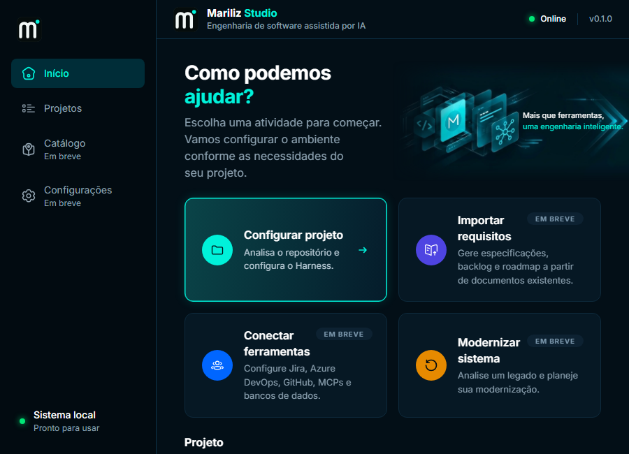
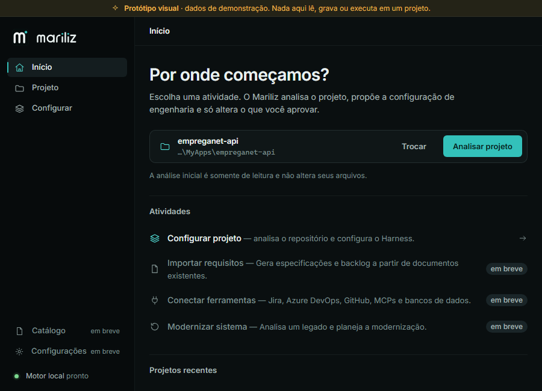
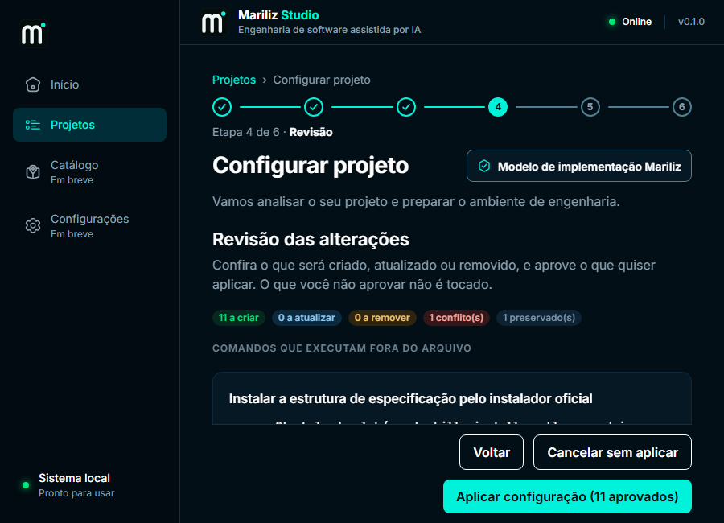
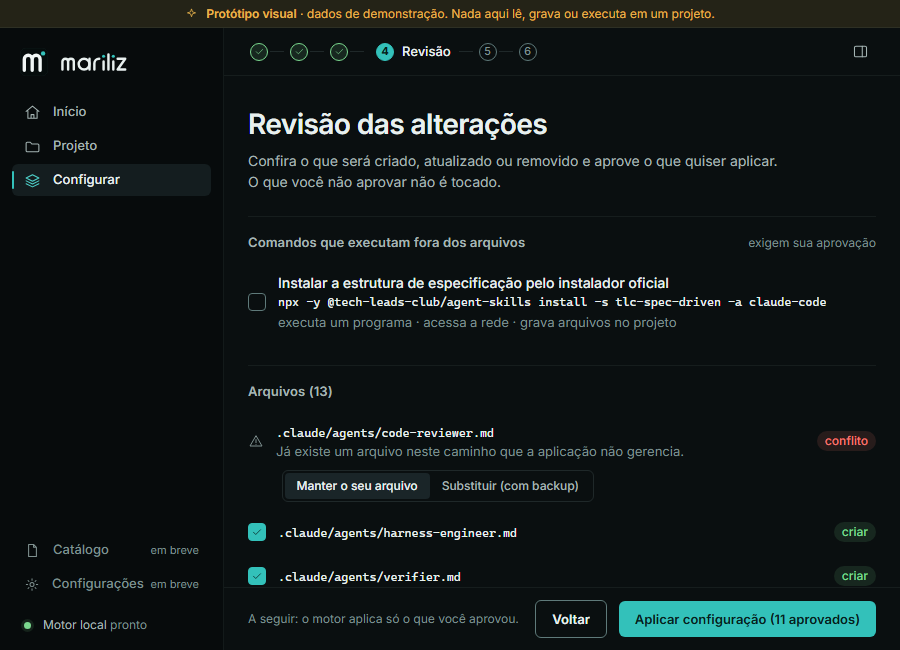
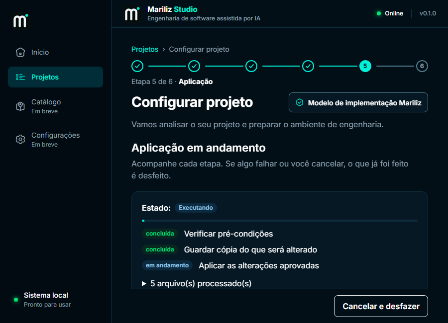
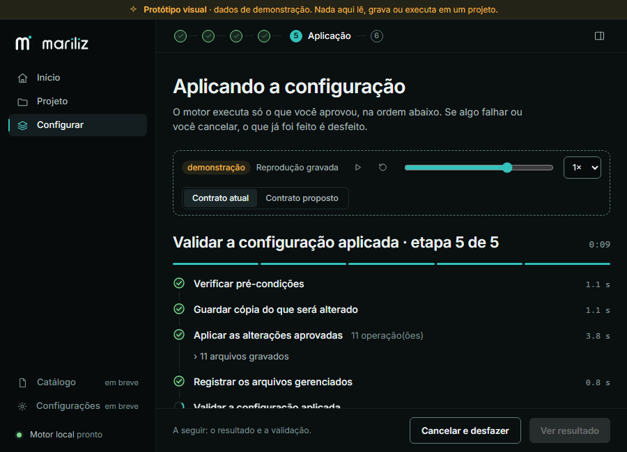
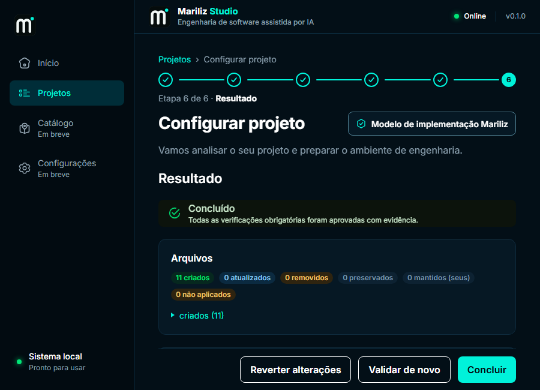
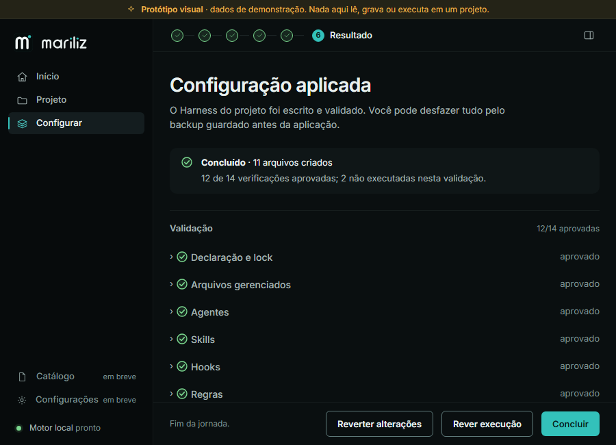

# Mariliz Studio — Redesign: auditoria, proposta e protótipo

> **Estado:** Fases 1 a 5 concluídas. **Nada da interface real foi substituído.** O protótipo vive em `apps/desktop-ui/src/prototype/` e `apps/desktop-ui/prototype.html`, fora do build de produção. A Fase 6 só começa depois da sua avaliação (seção 11).
>
> Documentos relacionados: [contratos-propostos.md](contratos-propostos.md) (eventos que o motor ainda não publica) e [ui-modernization.md](../ui-modernization.md) (desenho atual).

## Como ver o protótipo

```bash
pnpm --dir apps/desktop-ui exec vite --port 1420
# http://localhost:1420/prototype.html
```

Os dados são as respostas _golden_ do motor (`packages/contracts`), validadas pelos mesmos esquemas Zod do aplicativo. A faixa amarela no topo e o selo "demonstração" lembram que nada lê, grava ou executa em projeto algum. Links diretos úteis (parâmetros existem só no protótipo):

| Para ver | Endereço (depois de `prototype.html`) |
| --- | --- |
| Início | `#/` |
| Workspace do projeto | `#/projeto` |
| Análise em andamento / concluída | `#/configurar/projeto?estado=analisando` / `?estado=analisado` |
| Modelo e ambiente / gerando plano | `#/configurar/modelo` / `?estado=gerando-plano` |
| Plano | `#/configurar/plano` |
| Plano com agentes (contrato proposto) | `#/configurar/plano?contrato=proposto&t=5400` |
| Revisão | `#/configurar/revisao` |
| Aplicação (o que o motor publica hoje) | `#/configurar/aplicacao` (reproduz sozinha) ou `?t=9500` (instante fixo) |
| Aplicação (contrato proposto) | `#/configurar/aplicacao?contrato=proposto&t=11200` |
| Resultado e validação | `#/configurar/resultado` |

Capturas em 760×560 (mínimo do Tauri), 900×650 (tamanho inicial), 1280×800 e 1600×900: `docs/redesign/screenshots/`. As do desenho atual têm prefixo `atual-`.

### Antes e depois, na janela inicial do Tauri (900×650)

| | Desenho atual | Protótipo (Workbench) |
| --- | --- | --- |
| Início |  |  |
| Revisão |  |  |
| Aplicação |  |  |
| Resultado |  |  |

_As capturas do desenho atual usam o host simulado com as respostas golden do motor; as etapas Aplicação e Resultado são do mesmo fluxo, em instantes diferentes._

---

## 1. Problemas visuais encontrados (Fase 1)

Método: leitura do código (`apps/desktop-ui/src`, SCSS, tokens, tema da Synthra), execução do aplicativo atual no navegador com o host Tauri simulado pelas fixtures _golden_ (percorrendo as seis etapas a 900×650) e medição no DOM. Cada item abaixo foi **confirmado**; o que não se confirmou está na última linha da tabela.

| # | Hipótese do pedido | Veredito | Evidência concreta |
| --- | --- | --- | --- |
| 1 | Aparência baseada em cards | **Confirmado** | O mixin `card()` (`abstracts/_mixins.scss`) é a única superfície: borda 1 px + raio 12 + sombra. Há cartão dentro de cartão: `.specificationCard` contém `.subCard`; `.envItem` e `.pathField` têm borda própria dentro do cartão do ambiente. A etapa Resultado tem 14 elementos com borda e raio. |
| 2 | Excesso de bordas | **Confirmado** | Bordas de 1 px em cartões, campos, linhas de ambiente, chips e divisórias; item selecionado a 1,5 px **mais** brilho `--glow-card` (`0 0 15px rgb(0 242 218 / .15)`) e gradiente radial no cartão da estrutura (`panels.module.scss:672`). |
| 3 | Falta de hierarquia | **Confirmado** | Só seis tamanhos de fonte em uso (12, 13, 14, 16, 22, 28 px) e os títulos de seção são caixa alta com `letter-spacing: .08em` (`@mixin eyebrow`). Cinco camadas de cabeçalho antes do conteúdo: trilha, stepper, "Configurar projeto", selo do modelo, título da etapa. |
| 4 | Distribuição de espaço | **Confirmado** | A 900×650 o conteúdo da etapa Resultado começa em y = 313 px (48 % da altura) e a página tem 3 029 px (4,7 telas). Cabeçalho (56 px) e rodapé fixo (69 px) consomem 19 % da janela o tempo todo; na Revisão o rodapé quebra em duas linhas e cobre ~25 % do conteúdo. A marca aparece duas vezes (menu e barra superior). |
| 5 | Densidade excessiva | **Confirmado** | 27 elementos "chip" na etapa Resultado (`StatusChip` para estado, contagens, tipo, origem). Tabelas de decisões e de evals com 4–5 colunas em janela de 676 px úteis. |
| 6 | Parece formulário administrativo | **Confirmado** | `<select>` nativo, lista de rádios em linhas com borda, campo "Selecionar pasta do projeto" com botão "Analisar projeto" dentro de um cartão, rótulos em caixa alta. O ambiente de IA é pedido **duas vezes** (etapas Projeto e Modelo; o estado é o mesmo). |
| 7 | Falta de personalidade | **Confirmado, com nuance** | O único elemento expressivo é a imagem 3D do cabeçalho da tela inicial (`hero-banner.webp`); no resto a identidade se resume a um ciano neon sobre azul-marinho. **A cor de marca declarada (`#33C1BA`) só aparece no tema claro**; no escuro o primário é `#00F2DA` (`_tokens.scss`, `--cyan-400`). |
| 8 | Estados interativos pobres | **Confirmado** | Hover só troca fundo; seleção só troca borda; uma única duração (`--duration-fast: 120ms`); a troca de etapa é instantânea (`useScrollToTop`). Não há transição entre estados nem entrada de conteúdo. |
| 9 | Indicadores de processamento pouco expressivos | **Confirmado** | Análise: o botão vira "Analisando…" e aparece uma linha de texto **abaixo da dobra**; o resultado da análise também aparece abaixo da dobra, então a primeira tela parece não mudar. Plano: só o rótulo do botão do rodapé ("Gerando plano…"). Aplicação: chips + uma barra indeterminada de 4 px. Nada diz _quem_ está agindo. |
| 10 | Falta de integração entre etapas | **Confirmado** | Não há resumo persistente: o que foi escolhido (ambiente, aprovações) só existe dentro da etapa em que foi escolhido. O stepper informa a posição, mas não o que vem a seguir nem o que já foi decidido. |
| — | (extra) Dois temas | **Existe** | O tema segue o sistema operacional (claro e escuro) e ambos são testados por contraste. O pedido diz para não implementar dois temas sem decisão de produto: ver pergunta 2 na seção 11. |
| — | (extra) Botões da Synthra | **Defeito de tema** | O texto do `Button` vem de `typography.subtitle2` nos _overrides_ de tamanho da Synthra; o `styleOverrides.root` do tema do aplicativo **não o altera** (medido: 16 px, o documento diz 14). Corrigido no protótipo ajustando `subtitle2`. |
| — | (não confirmado) | **Sem problema** | Responsividade: o menu colapsa a 864 px e o conteúdo usa _container queries_; sem rolagem horizontal a 760×560. A semântica do código é boa (ESLint `jsx-a11y`, rótulos e `aria-current` nas etapas). A base técnica é boa; o problema é a linguagem visual. |
| — | (extra) **Rede de testes** | **Defeito** | O `ui-modernization.md` fala em 225 testes e em um teste de contraste dos tokens, mas o commit `81c00c3` ("feat: add format code") **removeu seis arquivos de teste** (shell, início, recentes, componentes de UI, esquema do motor e `tokens.contrast.test.ts`, ~1 100 linhas). Hoje restam 2 arquivos (49 testes) mais o do protótipo. São recuperáveis em `81c00c3^`. Ver pergunta 6. |

## 2. Comparativo com as referências (Fase 2)

Padrões que inspiram o Mariliz, e o que deliberadamente **não** copiamos.

| Referência | O que ela faz bem | Onde o Mariliz atual está | O que adotamos | O que não copiamos |
| --- | --- | --- | --- | --- |
| **ChatGPT Desktop** | Coluna central de leitura, navegação lateral discreta, campo de entrada como peça única, estado "pensando" que mostra o que está acontecendo sem logs | Cartões em grade; campo de pasta dentro de cartão | Coluna de leitura de ~46 rem; o campo do projeto como uma peça só (estilo _composer_); frase de estado viva e curta | Chat livre: o motor não conversa, e fingir isso seria desonesto |
| **Claude Desktop** | Minimalismo, muito ar, tipografia como hierarquia, quase sem bordas, ações discretas | Bordas em tudo, caixa alta, ícones em "poços" coloridos | Hierarquia por tamanho/peso/cor em vez de caixa; seções separadas por linha fina; botão secundário discreto | O tom "papel" quente: a marca Mariliz é teal sobre tinta |
| **Linear** | Design system rígido, listas densas porém calmas, indicadores de estado por **forma**, microinterações curtas, navegação previsível | Chips coloridos para tudo; tabelas | Linhas (não cartões) como unidade; `StatusGlyph` com forma própria por estado; item de menu com marca fina; durações 120–360 ms | Atalhos e paleta de comandos (não há funcionalidade para eles ainda) |
| **Cursor** | Painel lateral de atividade do agente, contexto de execução sempre à vista, feedback por evento | Progresso numa caixa única, sem "quem" nem "o quê" | **Painel de contexto** recolhível: resumo, participantes e atividade; linha do tempo de etapas | Edição inline de código e diffs como tela principal |

Síntese: o produto de IA "de alto nível" nessas referências comunica atividade por **estrutura** (linha do tempo, painel, glifos de estado), não por decoração. É o que a proposta faz.

## 3. Duas direções visuais (Fase 3)

### Direção A — **Workbench** (recomendada)

Estação de trabalho de engenharia: três regiões — menu estreito, **área de trabalho** central e **painel de contexto** recolhível à direita. Tinta quase preta com leve tom turquesa, `#33C1BA` como único acento. Listas planas e linhas finas; zero cartões.

```
┌─────────┬──────────────────────────────────────────┬────────────────┐
│ mariliz │ ✓ ✓ ✓ ✓ ⑤ Aplicação ─ ⑥        [painel ▢]│ Contexto     × │
│         ├──────────────────────────────────────────┤                │
│ Início  │ Aplicando a configuração                 │ Resumo         │
│ Projeto │ Validar a configuração · etapa 5 de 5 0:09│  Projeto …     │
│▌Config. │ ━━━━ ━━━━ ━━━━ ━━━━ ━━━━                 │  Ambiente …    │
│         │ ✓ Verificar pré-condições           1.1 s │ Participantes  │
│         │ ✓ Guardar cópia…                    1.1 s │  ◜ Motor Mariliz│
│ em breve│ ✓ Aplicar as alterações     11 operações  │    Em atividade│
│ Motor ● │ ◜ Validar a configuração aplicada        │ Atividade      │
│         ├──────────────────────────────────────────┤  0:08 Iniciou… │
│         │ A seguir: resultado.   [Cancelar] [Ver ▸]│                │
└─────────┴──────────────────────────────────────────┴────────────────┘
```

| | |
| --- | --- |
| **Vantagens** | A jornada é de **estado e aprovação**, não de conversa: linha do tempo, painel e glifos mostram isso sem inventar narrativa. Cada evento real do motor tem lugar certo. Resumo persistente resolve o problema 10. Escala bem de 760 a 1600 px (painel vira gaveta). Menor risco técnico: reaproveita jornada, reducer e contratos. |
| **Desvantagens** | Mais "ferramenta" que "produto de consumo": exige disciplina para não virar painel carregado. Painel lateral disputa largura em janelas pequenas (por isso gaveta). Requer evoluir componentes (seção 8). |

### Direção B — **Sessão** (conversa-canvas)

Uma única coluna centralizada como ChatGPT/Claude. Cada etapa é um "turno" numa conversa vertical: o Mariliz "diz" o que analisou, mostra um bloco para aprovar, o usuário responde com um clique. Operações viram blocos que crescem no fluxo. Campo fixo na base. Neutros quentes, serifa nos títulos.

```
┌─────────┬──────────────────────────────────┐
│ Sessões │      Configurar empreganet-api   │
│  hoje   │  ┌ Mariliz ───────────────────┐  │
│  ontem  │  │ Li o projeto: .NET net10.0 │  │
│         │  │ [Ver evidências]           │  │
│         │  └────────────────────────────┘  │
│         │  ┌ Plano ─────────────────────┐  │
│         │  │ 13 alterações  [Aprovar]   │  │
│         │  └────────────────────────────┘  │
│         │  ▸ Aplicando… ◜                  │
│         │  [ Pergunte ou peça algo…  ⏎ ]   │
└─────────┴──────────────────────────────────┘
```

| | |
| --- | --- |
| **Vantagens** | Familiar; narrativa natural de "uma IA trabalhando comigo"; layout simples e naturalmente responsivo. |
| **Desvantagens** | **Implica um interlocutor que não existe**: o motor é determinístico e o Harness Engineer roda fora. O campo de entrada prometeria conversa que não acontece. Texto narrado convida a prosa inventada (viola "estado verdadeiro"). Revisar 13 arquivos e dependências entre etapas numa linha do tempo de chat é ruim; voltar a uma etapa vira rolagem. Contexto persistente (resumo, aprovados) não tem lugar. |

### Recomendação: **A — Workbench**, com dois empréstimos de B

1. **Coluna de leitura** (46 rem) e o campo do projeto em peça única, no estilo _composer_.
2. Frase de estado viva ("Validar a configuração aplicada · etapa 5 de 5").

Justificativa em uma frase: o Mariliz é uma ferramenta de **configurar, aprovar e verificar**; a direção A mostra isso com estrutura honesta, enquanto B venderia uma conversa que o motor não tem.

## 4. Linguagem visual

### 4.1 Conceito: AI Engineering Workspace

Superfícies quase pretas, quase sem caixas. A **marca aparece onde há significado**: ação principal, foco, item atual do menu, etapa atual e **atividade viva** (arco girando, segmento "respirando"). Nada brilha sem estar fazendo algo.

### 4.2 Paleta (`src/prototype/styles/tokens.scss`)

| Papel | Token | Valor | Uso |
| --- | --- | --- | --- |
| Fundo | `--mz-bg` | `#0A0F10` | área de trabalho |
| Menu | `--mz-bg-rail` | `#070B0C` | menu lateral |
| Superfície | `--mz-surface` | `#0F1617` | gaveta, avisos, campo do projeto |
| Hover / ativo | `--mz-surface-hover/active` | `#141D1F` / `#1A2528` | linhas, item atual |
| Linhas | `--mz-line-subtle/line` | `rgb(160 200 196 / .08/.14)` | separadores |
| Borda de controle | `--mz-line-control` | `#5F7A7A` | campos, botões de contorno (≥ 3:1) |
| Texto | `--mz-text` · `-2` · `-3` | `#E8F0EF` · `#A5B5B4` · `#7F9190` | principal · secundário · terciário |
| **Marca** | `--mz-accent` | **`#33C1BA`** | botão primário, foco, atividade |
| Marca (texto) | `--mz-accent-text` | `#4FD3CC` | texto/ícone teal |
| Sucesso · alerta · erro | `--mz-success/warning/danger` | `#7BD88F` · `#E9B44C` · `#F2766E` | sempre com ícone e texto |
| Processando | `--mz-working` | = marca | "a inteligência está agindo" |

**Contraste validado por script** (todos os pares nas cinco superfícies): texto principal ≥ 15,8:1; secundário ≥ 8:1 em `surface`; terciário ≥ 5,5:1; marca como texto ≥ 10:1; marca como ícone/borda ≥ 8:1; borda de controle 3,4–4,3:1; estados semânticos ≥ 6,6:1; texto sobre o botão primário 7,6:1.

> **Decisão sua (pergunta 1):** o desenho atual usa o ciano `#00F2DA` (documento "design system Mariliz AI Engineering"). Esta proposta usa `#33C1BA`, que é a cor de marca citada no pedido e a do site, e retira o neon. Isso **substitui** uma decisão anterior; só implementarei com sua confirmação.

### 4.3 Tipografia

**Inter** (já empacotada; nenhuma dependência nova) + mono do sistema para caminhos e ids.

| Papel | Tamanho / peso | Uso |
| --- | --- | --- |
| Display | 28 / 600, −0,02 em | título da tela |
| Heading | 22 / 600 | frase de estado da operação |
| Body | 14 / 400–500 | texto de leitura, título de linha |
| Body-sm | 13 / 400–600 | **texto de interface** (densidade de desktop) |
| Caption | 12 / 500 | metadados, tempo, rótulos |
| Mono | 12 | caminhos, ids, tempo (`tabular-nums`) |

A hierarquia vem de tamanho, peso e cor. Caixa alta deixa de ser título de seção.

### 4.4 Forma, espaço, elevação, foco, movimento

- **Espaço:** base de 4 px (`--mz-1…7`); seções separadas por 24 px e uma linha fina.
- **Raio:** 6 px (controles), 10 px (campo do projeto, avisos), pílula só em etiquetas.
- **Elevação:** só gaveta/overlays (`--mz-shadow-overlay`). Painéis usam linhas, não sombras.
- **Foco:** anel de 2 px `--mz-focus` com _offset_ 2 px em tudo; `:has(input:focus-visible)` nos campos desenhados.
- **Estados interativos:** hover = fundo `surface-hover`; selecionado = marca fina (menu) ou contorno + fundo de marca a 12 % (escolhas); desabilitado = texto terciário.
- **Movimento:** `--mz-dur-1/2/3` = 120/220/360 ms, curva `cubic-bezier(.2,.7,.2,1)`. Animam **mudanças de estado** (item concluído, evento novo entrando, gaveta). Só duas animações contínuas, ambas _porque algo roda de fato_: o arco do `StatusGlyph` em andamento e o segmento ativo. Com `prefers-reduced-motion` as durações vão a ~0 e o arco fica parado; o texto "em andamento" continua dizendo o estado.

## 5. Novo conceito de workspace

**Menu (só o que existe):** Início · Projeto · Configurar; "Catálogo" e "Configurações" como **Em breve**, ditos em texto. Não criei Agentes, Ferramentas nem Avaliações: não há funcionalidade real por trás. Quando existirem entram no menu.

| Módulo sugerido no pedido | Existe hoje? | Onde fica no protótipo |
| --- | --- | --- |
| Início | sim | `#/` |
| Projetos | sim (projeto selecionado, recentes) | **Projeto**: inventário, stack, comandos, execuções |
| Engenharia | sim (é a jornada) | **Configurar** |
| Agentes · Ferramentas · Avaliações | não (são _componentes_ do plano e _Evals_ da validação) | Painel de contexto e etapa Resultado |
| Configurações | não | "Em breve" |

**Área central:** coluna de leitura. **Rodapé de ações** ancorado (nunca sobre o conteúdo) com a frase "A seguir: …". **Barra superior:** a jornada (`JourneyBar`) e o botão do painel.

**Jornada integrada.** As seis etapas e suas dependências são as mesmas (`project → model → plan → review → run → result`); etapas concluídas voltam, as futuras não são controles. Mudanças: o ambiente de IA é escolhido **uma vez** (etapa Modelo e ambiente); cada etapa mostra _o que acontece a seguir_; o resumo persistente mora no painel.

**Painel de contexto (recolhível):** Resumo → Participantes → Atividade. Em janelas ≥ 1180 px fica ao lado; abaixo vira **gaveta** com o botão de painel ganhando um ponto de atividade enquanto algo roda. Aberto por padrão só quando cabe.

**Desktop:** barra de título nativa (como hoje); menu colapsa em faixa de ícones abaixo de 864 px; barra de etapas mostra só a etapa atual abaixo de ~46 rem e "Etapa N de 6" abaixo de ~30 rem; rodapé e cabeçalho ocupam espaço próprio (não cobrem conteúdo); rolagem só na área de trabalho.

## 6. Visualização das operações de IA

### 6.1 O que o motor realmente publica hoje (verificado no C#)

| Fonte | O que existe | Onde |
| --- | --- | --- |
| `harness.apply` (run) | `run.state` (running, validating), `step.started/completed` (**precheck, backup, command:*, write, lock, validate**), `file.applied` (path, op), `run.completed` | `ApplyExecution.cs`, `RunJournalRecorder.cs`, `RunHandle.cs` |
| `harness.validate` / `revert` | `step.*`, `file.reverted` | `ValidationService`, `RevertService.cs` |
| `project.discover`, `harness.plan` | **Nada**: chamadas únicas com resposta final | `ProtocolMethods.cs` |
| Evals (14) | Resultado final no `RunResult`; **sem evento por Eval** | `EvalRunner.cs` |
| Agentes | **Não há execução de agentes no motor.** O Harness Engineer roda no ambiente de IA da pessoa; o motor só lê `.mariliz/proposal.json` | `harness-engineer-prompt.ts`, `ProposalReader.cs` |

Consequência: a composição "Harness Engineer: Analisando projeto · Architecture Reviewer: Aguardando…" **não pode ser mostrada com verdade hoje**. O protótipo mostra o que é verdadeiro e deixa o resto como contrato proposto, claramente marcado.

### 6.2 Composição escolhida

Entre linha do tempo, painel de agente, eventos em tempo real e resumo, a composição é:

1. **Linha do tempo de etapas** na área de trabalho (Aplicação): uma linha por etapa, na ordem do motor, com glifo de estado, detalhe e duração. Arquivos aparecem enquanto são gravados e se recolhem num resumo ao concluir.
2. **Frase de estado** (região `role="status"`): "Validar a configuração aplicada · etapa 5 de 5" + tempo. Uma frase por etapa, não por arquivo.
3. **Segmentos de progresso** (um por etapa; **não é percentual**).
4. **Painel de contexto**: _Participantes_ (quem age e o que faz) e _Atividade_ (últimos eventos em linguagem de pessoa).
5. **Resultado** (Resultado): veredito em uma frase, depois a lista de verificações (aprovado/reprovado/bloqueado/não executado, expansível com critério e evidências) — nada de tabela.

Estados "aguardando aprovação": ficam na **Revisão** (aprovar é a etapa), e `awaiting_approval` existe em `RunStates` mas não é emitido hoje (ver 9).

### 6.3 Participantes (apenas fatos)

| Participante | Estado vem de | Hoje |
| --- | --- | --- |
| **Motor Mariliz** | `run.state` + etapa em andamento | real |
| **Harness Engineer** | existência de proposta (`proposalOrigin`, limitação `HARNESS_ENGINEER_NOT_INVOKED`) | real: "Aguardando proposta" + nota "roda no seu ambiente de IA" |
| **Juiz por modelo** | `EV-JUDGE-001` no resultado | real: "Não iniciado — não executado nesta validação" |
| Agentes instalados (harness-engineer, code-reviewer, verifier) | `plan.decisions` / `plan.changes` | são **componentes configurados**, não processos; aparecem no plano, não como "ativos" |
| Atividade ao vivo de agentes | eventos `agent.state` | **lacuna**: só no modo "Contrato proposto (demonstração)" |

O alternador **Contrato atual / Contrato proposto** na barra de reprodução permite avaliar o desenho com e sem os eventos que faltam. O modo proposto é sempre rotulado "demonstração". Nenhum agente fora do catálogo real foi criado.

## 7. Componentes da Synthra reutilizados

| Componente / API | Uso no protótipo |
| --- | --- |
| `Provider` + `initializeTheme({ overrides })` | Tema da nova identidade **por _overrides_**, sem tocar a biblioteca (`theme.ts`) |
| `Button` (contained / outlined / text) | Todas as ações; secundária refinada via tema |
| Ícones (`Home01Icon`… 440) | Hoje o app usa 14. Mantidos onde há equivalente |
| `Modal` | Confirmação de reversão (já usado; mantido) |
| `Alert` | Erro bloqueante (já usado; mantido) |
| `Checkbox`, `Switch`, `TextField`, `SelectField` | Disponíveis; o protótipo desenha a caixa/rádio sobre o `<input>` nativo (mesmo acesso) para o contexto de lista; avaliar adotar na Fase 6 |

## 8. Componentes que precisam evoluir (ou ser compostos)

A Synthra **não tem**: stepper, timeline, indicador de estado, tooltip, popover, tag, seção/lista, skeleton, painel de contexto. Proposta de composição (no app) e candidatas à Synthra:

| Novo | O que é | Onde | Candidato à Synthra? |
| --- | --- | --- | --- |
| `StatusGlyph` | Forma por estado (anel, arco, marca, triângulo, X, traço) + texto acessível | `ui/primitives` | **Sim** |
| `Tag` | Etiqueta textual com 5 tons | `ui/primitives` | Sim |
| `Section` / `Row` | Seção com linha fina; linha de lista com hover | `ui/primitives` + `screen.module.scss` | Não (app) |
| `JourneyBar` | Stepper compacto com estados em texto, adaptável por container | `configure/journey-bar` | Sim (substitui `WizardSteps`) |
| `OperationTimeline` + `buildOperation` | Linha do tempo a partir de eventos | `configure` + `domain/operation-model` | Não (app) |
| `Stage` + painel de contexto | Barra, rolagem, ações ancoradas, painel/gaveta | `shell/` | Não (app) |
| `Glyph` | 24 ícones de traço (pausa, chevron, painel, pasta…) | `ui/glyph` | **Sim** (lacuna de ícones) |
| Tema | `typography.subtitle2/caption` e _outlinedInherit_ | `theme.ts` | Documentar na lib |

## 9. Limitações da arquitetura atual

Cada uma está detalhada, com o contrato mínimo, em [contratos-propostos.md](contratos-propostos.md).

1. **Sem eventos em `project.discover` e `harness.plan`.** Análise e planejamento são chamadas únicas; a interface só pode dizer "o motor não informa o andamento". O motor já executa detectores em sequência: publicar `discover.probe` é barato.
2. **Sem execução de agentes no motor.** A atividade do Harness Engineer, de um Verifier ou do juiz **não é observável**. Mostrá-la exige uma decisão de produto: o motor passar a orquestrar o agente (adaptador) ou ler um canal de eventos do ambiente de IA.
3. **Evals sem eventos individuais.** A validação é uma etapa de ~5 s; os 14 resultados chegam juntos ao fim.
4. **Eventos sem carimbo de tempo.** Durações são medidas no cliente na recepção; um reinício da interface perde a precisão. Propor `at` (ISO 8601).
5. **Etapas esperadas não são declaradas.** A interface precisaria conhecer a lista (precheck, backup, write, lock, validate) e os títulos (que estão em strings do C#). Propor `run.plan`.
6. **Estados definidos e não emitidos.** `RunStates.Analyzing` e `AwaitingApproval` existem e nenhum código os publica.
7. **`file.applied` não traz o tipo do componente.** Dá para agrupar por tipo cruzando com `plan.changes` (sem mudar contrato), mas ficaria mais simples com `kind`.
8. **Tema da Synthra:** a tipografia do `Button` não responde a `styleOverrides.root`; paleta duplicada em SCSS e em `brand-palette.ts` (duas fontes de verdade).
9. **Tauri:** só barra de título nativa e tamanho mínimo 760×560; o tema segue o sistema operacional sem preferência persistida.

## 10. Plano de implementação incremental (Fase 6, após aprovação)

Cada fatia entrega valor, mantém `pnpm check` verde e não muda regra de negócio nem contrato.

| # | Fatia | Conteúdo | Verificação |
| --- | --- | --- | --- |
| 0 | **Decisões e rede de testes** | Cor da marca, tema(s), rótulos (seção 11); **restaurar os testes removidos em `81c00c3`** (pergunta 6) para ter com o que comparar | sua resposta; `pnpm check` |
| 1 | **Tokens e tema** | Novos tokens no `_tokens.scss`; tema Synthra por _overrides_; unificar `brand-palette.ts` com o SCSS; `tokens.contrast.test.ts` restaurado e atualizado | `tokens.contrast.test.ts` |
| 2 | **Primitivos** | `StatusGlyph`, `Tag`, `Section/Row`, `Glyph` em `shared/components/ui` com testes e axe | testes + axe |
| 3 | **Moldura** | `AppShell` → Workbench (menu, `Stage`, painel de contexto, gaveta); remove topbar duplicada | testes do shell; 760/900/1280 |
| 4 | **Início e Projeto** | Início em linhas; nova tela Projeto (dados reais de `discover`/`runs`) | testes de feature |
| 5 | **Jornada (etapas 1–4)** | `JourneyBar`; etapas migram uma a uma para o novo layout; ambiente pedido uma vez; mesmo reducer | `configure-project-page.test` + `journey-state.test` |
| 6 | **Operação** | `OperationTimeline` e Participantes consumindo `RunEvent` reais; fim do `.progress` genérico | testes com dublê do `HarnessApi` |
| 7 | **Resultado** | Lista de verificações expansível; próximo passo do Harness Engineer | testes |
| 8 | **Contratos** (com .NET) | `run.plan`, `eval.*`, `at`, `discover.probe`; fixtures _golden_ e Zod | `packages/contracts` + testes .NET |
| 9 | **Validação final** | Responsivo (760–1600), contraste efetivo no navegador, teclado, leitor de tela (NVDA/Narrator), zoom/alto contraste, comparação com este protótipo | relatório |

As fatias 1–7 não dependem do .NET; a 8 melhora a fidelidade (hoje o protótipo as exibe como "contrato proposto"). A 6 já entrega Participantes honestos com o que existe.

## 11. Decisões que preciso de você

1. **Cor de marca no escuro:** adotar `#33C1BA` (proposta) ou manter o ciano `#00F2DA` do documento de design system atual?
2. **Temas:** a proposta é **escuro apenas** nesta fase (o claro hoje existe e é testado). Manter o claro como derivado, ou remover?
3. **Direção:** aprova A (Workbench) ou quer explorar B (Sessão) em protótipo?
4. **Rótulo da etapa 2:** o pedido diz "Método e ambiente"; o produto usa "Modelo e ambiente" (decisão anterior de linguagem). Mantenho "Modelo e ambiente"?
5. **Agentes ao vivo:** devo tratar a orquestração de agentes pelo motor como uma iniciativa separada de produto, ou prefere que a Fase 6 se limite ao que o motor publica hoje (mais os contratos da fatia 8)?
6. **Testes removidos:** o commit `81c00c3` apagou seis arquivos de teste da UI. Foi intencional? Se não, restauro-os (de `81c00c3^`) como primeira fatia da Fase 6, adaptando o que a nova interface mudar.

## 12. Validação feita até aqui (honesta)

| Verificação | Resultado |
| --- | --- |
| `pnpm check` completo em `apps/desktop-ui` (tsc, ESLint, Prettier, Vitest) | passa: 56 testes, dos quais 7 novos cobrem `buildOperation` (os dois contratos e a regra "sem evento, sem agente") |
| Contraste dos tokens (script, 5 superfícies, 45+ pares) | todos passam |
| axe-core no navegador (WCAG 2.0/2.1/2.2 A/AA) | 0 violações em Resultado; `color-contrast` marcado "incompleto" pelo axe, por isso foi feito o próximo item |
| Auditor de contraste **efetivo** (cor computada composta com o fundo) em 8 telas a 1280 px | 0 falhas, exceto botões **desabilitados** (isentos na WCAG 1.4.3) |
| Responsivo | capturas a 760×560, 900×650, 1280×800, 1600×900 (ver `screenshots/`) |
| **Não feito** | leitor de tela real; zoom do sistema e alto contraste; execução dentro do Tauri; teste de usuários; 100 % da navegação por teclado (apenas a ordem do DOM e foco visível por CSS) |

---

## 13. Fase 6 — estado da implementação (direção A aprovada)

Decisões tomadas com a aprovação: direção A (Workbench), `#33C1BA`, **tema escuro único**. As demais perguntas seguiram o padrão da proposta: "Modelo e ambiente" mantido; Fase 6 limitada ao que o motor publica hoje (sem agentes ao vivo); testes removidos em `81c00c3` restaurados.

| Fatia | Estado | O que mudou |
| --- | --- | --- |
| 0 · Testes | feito | Seis arquivos restaurados de `81c00c3^`; `engine.test.ts` atualizado para o nome `specification`; contraste agora de um tema só |
| 1 · Tokens e tema | feito | `_tokens.scss` reescrito (escuro, `#33C1BA`, linhas finas, sem brilho); tema Synthra por _overrides_ (inclui `subtitle2`/`caption` dos botões); `brand-palette.ts` com teste de paridade contra o SCSS; tema claro removido |
| 2 · Primitivos | feito | `StatusGlyph` e `Glyph` em `shared/components/ui`; `StatusChip` segue como etiqueta |
| 3 · Moldura | feito | `AppShell` em Workbench: menu com marca fina, faixa fina de estado, só a área de trabalho rola, marca só no menu |
| 4 · Início e Projeto | feito (Início) | Início em linhas, sem arte, campo do projeto em peça única, recentes em linhas. A tela "Projeto" do protótipo **não** foi criada: depende de listar execuções por projeto e foi deixada para a próxima rodada |
| 5 · Jornada | feito | Barra de etapas compacta (`WizardSteps`, mesma semântica), painel de contexto recolhível (gaveta abaixo de ~62 rem de coluna), seções sem caixa (`card()` virou seção), títulos em frase |
| 6 · Operação | feito | Linha do tempo com etapas planejadas "aguardando", frase de estado, segmentos, tempo (medido no cliente), feed e Participantes **só com fatos** (motor, proposta do Harness Engineer, juiz por modelo) |
| 7 · Resultado | parcial | Herda o novo visual; a tabela de Evals segue como tabela (a lista expansível do protótipo fica para a próxima rodada) |
| 8 · Contratos | não iniciado | Depende de mudanças no .NET (ver `contratos-propostos.md`) |
| 9 · Validação | parcial | Ver abaixo |

**Verificação desta rodada** (`pnpm check` em `apps/desktop-ui`): `tsc`, ESLint, Prettier e **204 testes** passam (20 novos: etapas planejadas, reducer de progresso, painel de contexto com regras "sem evento não há agente" e juiz "não executado", paridade de paleta). No aplicativo real com o host simulado pelas fixtures _golden_: axe-core com **0 violações** e auditor de contraste efetivo com **0 falhas** em Revisão, Aplicação (em andamento) e Resultado; capturas a 760×560, 900×650, 1280×800 e 1600×900 em `screenshots/implementado-*`.

**Não verificado:** leitor de tela real, zoom do sistema, alto contraste do Windows, execução dentro do Tauri (as capturas são do front-end em navegador), Análise/Modelo/Plano passaram só na inspeção visual e nos testes, e o desenho interno das etapas 1–4 ainda usa os componentes antigos com o novo visual (por exemplo o cartão "Estrutura de especificação" e as colunas da etapa Projeto).

**Mudanças de comportamento a conferir:** o tema claro deixou de existir; a arte do cabeçalho do Início (`hero-banner.webp`, `hero-art.tsx`) foi removida; a faixa superior perdeu a marca e o nome (ficam no menu); "Em breve" no menu passou a ficar à direita do nome.
